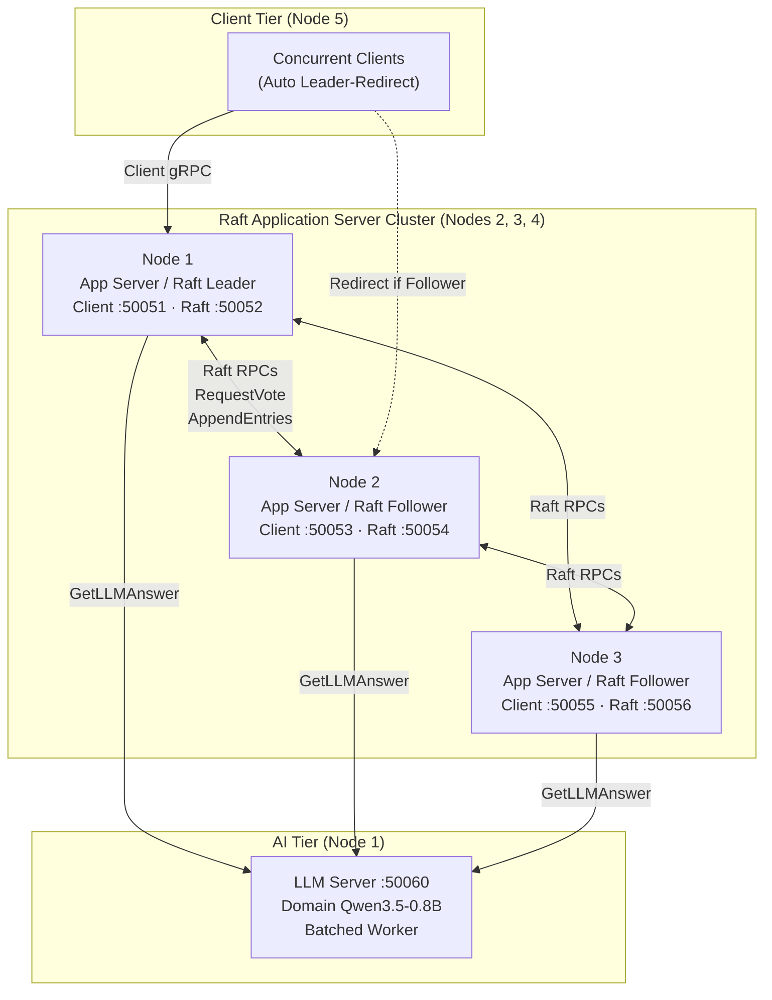
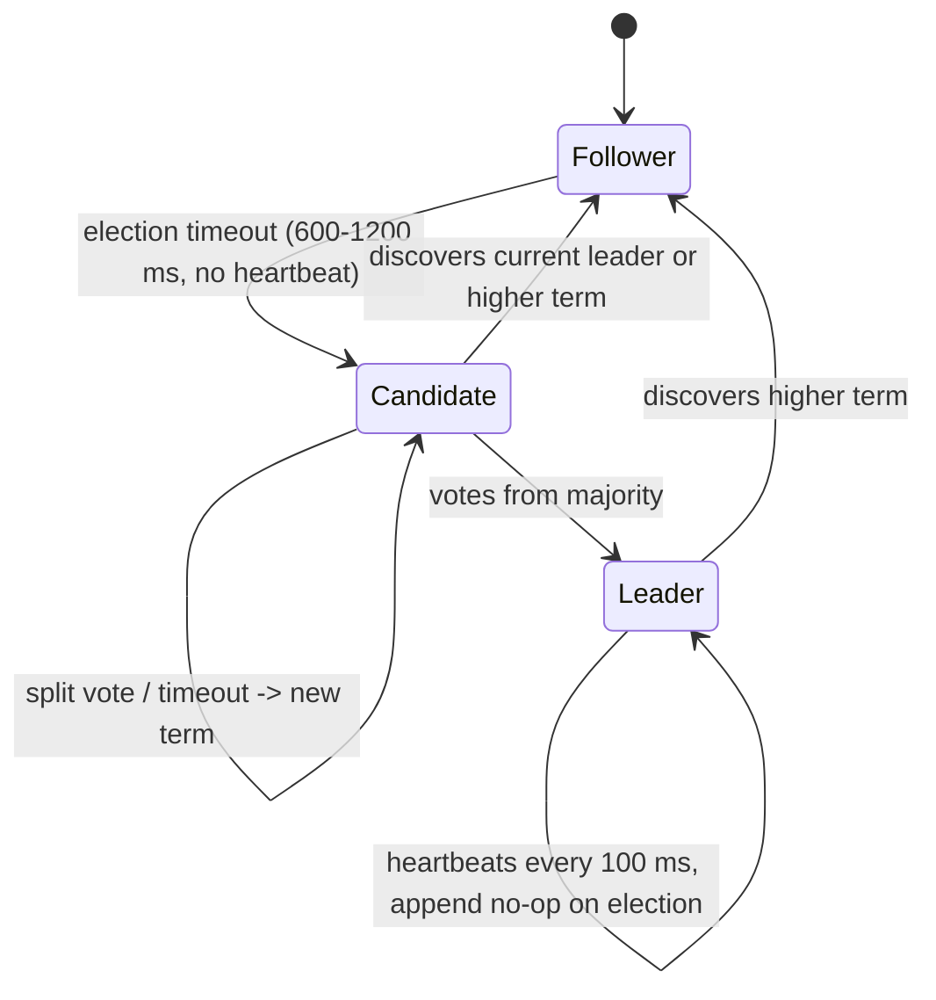
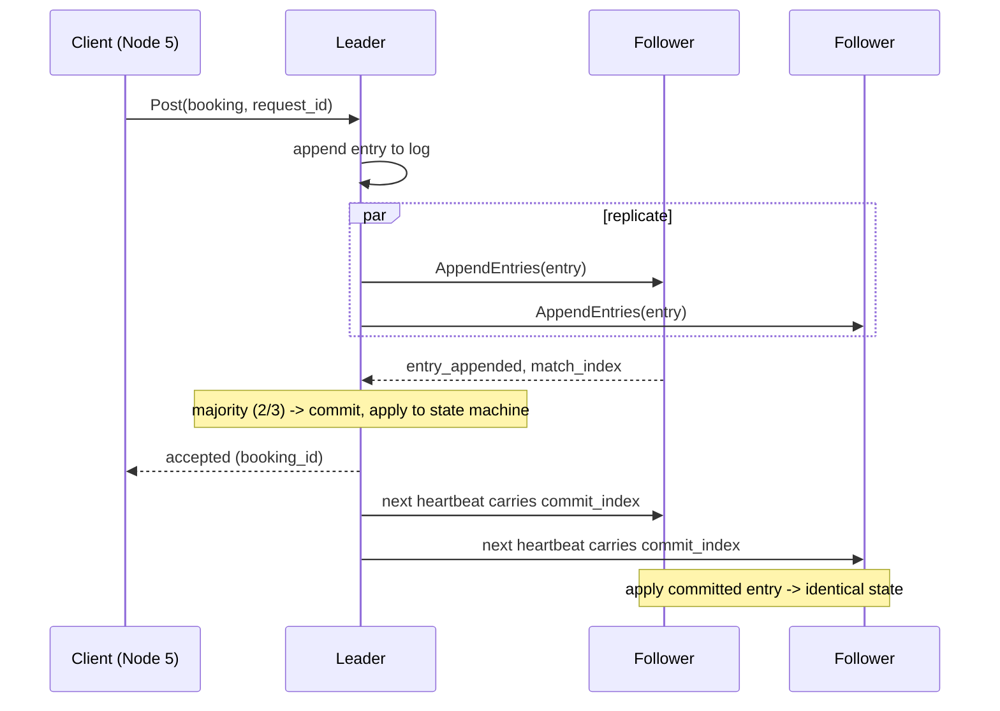

# Distributed Ticket Booking System

**CS G623 Advanced Operating Systems · BITS Pilani · Semester I 2026–27**
Architecture A (Distributed Ticket Booking), instantiated as a **distributed vaccine-slot booking platform**.
**Status: Milestone 1 & Milestone 2 (Raft Consensus & Fault Tolerance) COMPLETE.**

A gRPC-based, multi-node distributed booking system in Python implementing the **Raft Consensus Protocol** (Ongaro & Ousterhout). The system replicates state across a cluster of application server nodes, provides strong consistency for bookings and sessions, automatically elects a new leader upon node failure, and integrates a domain-specific LLM service (`Qwen3.5-0.8B` on CUDA/Apple MPS, with keyword fallback) running on an independent node.

---

## Contents

[Milestones Deliverables](#milestones-deliverables) · [Architecture](#architecture) · [Demo Topology](#demo-topology-5-nodes) · [Raft Consensus Implementation](#raft-consensus-implementation) · [gRPC Contract](#grpc-contract) · [Quick Start & Setup](#quick-start--setup) · [Running the Demos](#running-the-demos) · [Multi-Machine Deployment](#multi-machine-deployment) · [Testing](#testing) · [Project Structure](#project-structure)

---

## Milestones Deliverables

| Deliverable | Description / Location | Status |
|---|---|---|
| **gRPC Service Architecture** | `proto/ticket_service.proto`: `TicketClientService`, `TicketAppService`, `LLMService`, `RaftService` | ✅ Complete |
| **Authentication & Replicated Sessions** | Replicated via Raft; seamless client redirection on leader change | ✅ Complete |
| **Domain-specific AI / LLM Server** | Independent CPU-friendly node (`llm/domain_llm.py`, `scripts/run_llm_server.py`) | ✅ Complete |
| **Raft Consensus Algorithm** | Complete implementation (`src/dist_ticket_booking/raft/`): Leader Election, Log Replication, Commit advancement | ✅ Complete |
| **Distributed Data Consistency** | Strong consistency: bookings & cancellations commit only after majority replication | ✅ Complete |
| **Crash Recovery & Persistence** | State (`current_term`, `voted_for`, `log`) persisted to stable JSON storage | ✅ Complete |
| **Fault Tolerance & Leader Failure** | Automatic heartbeat failure detection, leader re-election, zero data loss (`scripts/demo_fault_tolerance.py`) | ✅ Complete |
| **Multi-Node Cluster Orchestration** | `scripts/run_cluster.py --nodes N` (3 or 5 nodes; tolerates ⌊(N−1)/2⌋ failures) | ✅ Complete |
| **Quorum-Loss Handling** | Leader cut off from the majority rejects writes immediately with a clear `unavailable` error (CheckQuorum) | ✅ Complete |
| **Stress Testing** | 40 concurrent clients on one slot, leader crash under load, cancel-after-failover (`tests/test_raft_stress.py`) | ✅ Complete |
| **End-to-End Verification** | 33 live checks: LLM, failover, quorum loss, full restart, 5 nodes, log compaction (`scripts/verify_milestone2.py`) | ✅ Complete |
| **5-Node Demo Topology** | LLM node + 3 Raft nodes + client node with leader kill under load (`scripts/demo_full_system.py`) | ✅ Complete |
| **Client Node (Node 5)** | Concurrent user simulator with stats and a consistency audit (`scripts/run_clients.py`) | ✅ Complete |

**Extras beyond the minimum requirements**

| Extra | Description |
|---|---|
| **Log compaction + `InstallSnapshot` RPC** | Automatic snapshots every 200 entries (`--snapshot-threshold`); lagging followers catch up from the leader's snapshot (Raft §7) |
| **Exactly-once writes** | Every booking/cancel carries a `request_id`; the replicated state machine de-duplicates retries (Raft §8) |
| **Leader no-op + read barrier** | New leaders commit a no-op before serving reads, so reads are never stale (Raft §8) |
| **CheckQuorum fail-fast** | Leaders cut off from the majority reject requests instantly with a clear error |
| **Replica state digest** | Every node reports a hash of its state; the monitor flags `IDENTICAL` vs `DIVERGED` replicas |
| **LLM grounding + back-pressure** | Policy-fact guardrail, live-context focusing, bounded in-flight LLM calls with keyword fallback |
| **Live cluster monitor** | `scripts/monitor_cluster.py`: role, term, commit/applied index, log size, state digest, LLM status |

---

## Architecture



---

## Demo Topology (5 nodes)

The assignment's suggested layout, as run by `scripts/demo_full_system.py` (one machine) or by the per-machine commands in [Multi-Machine Deployment](#multi-machine-deployment):

| Assignment node | Role | Process | Ports |
|---|---|---|---|
| **Node 1** | AI/LLM server (Qwen3.5-0.8B), independent | `scripts/run_llm_server.py` | `:50060` |
| **Node 2** | App server + Raft (initial leader) | `run_node.py --node-id node-1` | client `:50051` · raft `:50052` |
| **Node 3** | App server + Raft follower | `run_node.py --node-id node-2` | client `:50053` · raft `:50054` |
| **Node 4** | App server + Raft follower (redundancy) | `run_node.py --node-id node-3` | client `:50055` · raft `:50056` |
| **Node 5** | Client node: many concurrent users | `scripts/run_clients.py` | — |

Leadership is decided by Raft, so whichever app node wins the first election plays "Node 2". Any app node can be killed; the other two keep serving.

---

## Raft Consensus Implementation

The consensus engine is implemented from the ground up in `src/dist_ticket_booking/raft/`:

1. **Leader Election (`RaftNode`)**:
   - Nodes transition between `FOLLOWER`, `CANDIDATE`, and `LEADER`.
   - Randomized election timeouts (600–1200 ms, heartbeat 100 ms) prevent split votes; the range is wider than the paper's 150–300 ms so Python process stalls do not trigger spurious elections.
   - Candidates solicit votes via `RequestVote` RPCs; win leadership upon securing a majority ($\lfloor N/2 \rfloor + 1$).
2. **Log Replication**:
   - The Leader accepts client requests via `propose(command_type, command)`.
   - Commands are appended to the local log and replicated via `AppendEntries` RPCs.
   - Once acknowledged by a majority, the Leader increments `commit_index` and applies the entry to the `StateMachine`.
3. **State Machine (`StateMachine`)**:
   - Applies committed log entries to the `BookingService` (slot inventory, appointment records) and session store.
   - Guarantees deterministic convergence across all surviving nodes. Booking IDs are derived from the log index, so every replica assigns the same ID (cancellations keep working after failover).
4. **Crash Recovery & Persistence (`RaftLog`)**:
   - `current_term`, `voted_for`, and the complete `log` are safely persisted to disk.
   - Upon reboot, a crashed node reloads its state, replays committed log entries, reconnects to the cluster, and synchronizes missing entries with the active Leader.
5. **Commit-safe recovery**:
   - `commit_index` is persisted as a lower bound; on restart a node replays only entries known to be committed. Uncommitted leftovers are applied only once a leader's commit index covers them (they may be overwritten).
   - A new leader appends a **no-op** entry in its own term; committing it commits all earlier entries (Raft §5.4.2), and the leader serves reads only after that (read barrier).
   - A node casts at most one vote per term (`votedFor` is only reset when the term increases).
6. **Log compaction (`InstallSnapshot`)**:
   - After `--snapshot-threshold` entries (default 200) a node snapshots its state machine (point-in-time deep copy) and discards the compacted log prefix.
   - If a follower needs entries the leader has compacted, the leader sends its snapshot via the `InstallSnapshot` RPC; the follower installs it and continues with normal `AppendEntries`.
7. **Quorum checks & client behaviour**:
   - The leader tracks the last acknowledgement from each follower; without a recent majority it rejects requests at once (`status="unavailable"`, "no quorum") instead of blocking.
   - `TicketClient` follows leader redirects and rides out elections: it backs off while no leader is known, and rotates through its seed nodes if the node it talks to is unreachable.
   - **Exactly-once writes**: each booking/cancel carries a client-generated `request_id` that stays the same across retries. The state machine caches results by `request_id` (included in snapshots), so a retried write whose reply was lost in a crash returns the original result instead of being applied again.





### LLM Integration (Node 1)
- Model: **Qwen/Qwen3.5-0.8B**, loaded offline from the HuggingFace cache; device auto-selected (CUDA → Apple MPS → CPU), thinking mode disabled. ~2–4 s per answer on MPS.
- **Context-aware**: the app server injects live, Raft-replicated slot availability (filtered to the vaccine/city asked about) into the prompt, plus the matching policy rule.
- **Grounding guardrail**: if the model drops or inverts a key policy number (e.g. the 24-hour cancellation deadline), the verified policy text is returned instead.
- **Resilience**: app-server → LLM calls have a deadline (`LLM_TIMEOUT_S`, default 30 s); if the LLM node is down or too slow, a keyword-based answer is returned and bookings are unaffected.

---

## gRPC Contract

All communication occurs via gRPC as defined in `proto/ticket_service.proto`:

### Client & Application RPCs
- `Login(LoginRequest) -> LoginResponse`: Authenticates user, replicates session token via Raft.
- `Logout(LogoutRequest) -> StatusResponse`: Terminates session across cluster.
- `Post(PostRequest) -> StatusResponse`: Submits write operations (`booking`, `cancel`).
- `Get(GetRequest) -> GetResponse`: Queries read operations (`availability`, `faq`).
- `ProcessBusinessRequest(BusinessRequest) -> StatusResponse`: Inter-service business dispatch.

### Raft Consensus RPCs
- `RequestVote(RequestVoteRequest) -> RequestVoteResponse`: Candidate leader election voting (`from, to, term, lastLogIndex, lastLogTerm` → `from, to, term, voteGranted`).
- `AppendEntries(AppendEntriesRequest) -> AppendEntriesResponse`: Leader log replication & heartbeat (`from, to, term, prevIndex, prevTerm, commitIndex, entries` → `from, to, term, entryAppended, matchIndex`).
- `InstallSnapshot(InstallSnapshotRequest) -> InstallSnapshotResponse`: Ships the leader's snapshot to a follower behind the compacted log.

To regenerate stubs:
```bash
bash scripts/generate_grpc.sh
```

---

## Quick Start & Setup

### Requirements
- Python 3.10+ (recommended: conda environment `AOS` or standard virtual environment).

### Installation

```bash
# Using Conda:
conda activate AOS

# Or using standard venv (Python 3.10+ required; macOS system python3 is 3.9):
python3.11 -m venv .venv && source .venv/bin/activate

# Install dependencies and editable package:
pip install -r requirements.txt && pip install -e .   # pinned versions
# or: pip install -e ".[llm,test]"
```

---

## Running the Demos

### 1. Fault Tolerance & Leader Recovery Demo (Viva Demonstration)

Demonstrates the primary Milestone 2 requirements:
1. Boots a 3-node Raft cluster.
2. Books tickets through the elected Leader.
3. **Kills the Leader mid-operation (`SIGKILL`)**.
4. Surviving nodes detect heartbeat timeout and elect a **new Leader**.
5. Client seamlessly continues booking through the new Leader with **zero data loss**.
6. Crashed node is restarted, recovers state from disk, and catches up with the latest log entries!

```bash
python scripts/demo_fault_tolerance.py
```

### 2. Distributed Raft Replication & Follower Redirect Demo

Demonstrates multi-node replication and client transparent auto-redirect:

```bash
python scripts/demo_raft.py
```

### 3. Full 5-Node System Demo (recommended)

Starts the LLM node and 3 Raft nodes, runs the client node (20 concurrent users: bookings, cancels, availability, FAQ), **kills the leader at t=10 s under load**, restarts it at t=18 s, and finishes with the client's consistency audit and the cluster monitor (all replicas must show the same state digest):

```bash
python scripts/demo_full_system.py               # add --no-llm for Raft only
```

Run the client node on its own against any running cluster:
```bash
python scripts/run_clients.py --users 30 --duration 20 --faq
```

### 4. End-to-End Milestone 2 Verification

Starts real multi-process clusters and prints PASS/FAIL for 33 checks: LLM FAQ via leader/follower, live availability answers, concurrent queries, FAQ after leader kill, LLM-server outage, follower crash, quorum loss (fail-fast), quorum restore, full-cluster crash + recovery, a 5-node cluster surviving 2 failures, and log compaction with `InstallSnapshot` catch-up.

```bash
python scripts/verify_milestone2.py             # ~2 min, includes the LLM
python scripts/verify_milestone2.py --skip-llm  # Raft-only, faster
python scripts/run_all_demo.py                  # tests + all demos + verification + full system
```

### 5. Running a Cluster Interactively

To start the cluster (with the LLM server) and keep it running:

```bash
python scripts/run_cluster.py --nodes 3 --with-llm   # or --nodes 5
```

- **Node 1**: Client port `50051` · Raft port `50052`
- **Node 2**: Client port `50053` · Raft port `50054`
- **Node 3**: Client port `50055` · Raft port `50056`

Run client interactions against any node, and watch the cluster live:
```bash
python scripts/client_demo.py localhost 50051
python scripts/monitor_cluster.py              # --nodes 5 for a 5-node cluster
```

---

## Multi-Machine Deployment

Every process binds to all interfaces and is addressed by `host:port`, so the same scripts run across separate machines. Example with the LLM on `10.0.0.1`, app nodes on `10.0.0.2–4` and the client node anywhere (peer format: `node-id:host:raft_port:client_port`):

```bash
# Node 1 (10.0.0.1): LLM server
python scripts/run_llm_server.py --port 50060

# Node 2 (10.0.0.2)
python scripts/run_node.py --node-id node-1 --client-port 50051 --raft-port 50052 \
  --peers "node-2:10.0.0.3:50054:50053,node-3:10.0.0.4:50056:50055" --llm-host 10.0.0.1

# Node 3 (10.0.0.3)
python scripts/run_node.py --node-id node-2 --client-port 50053 --raft-port 50054 \
  --peers "node-1:10.0.0.2:50052:50051,node-3:10.0.0.4:50056:50055" --llm-host 10.0.0.1

# Node 4 (10.0.0.4)
python scripts/run_node.py --node-id node-3 --client-port 50055 --raft-port 50056 \
  --peers "node-1:10.0.0.2:50052:50051,node-2:10.0.0.3:50054:50053" --llm-host 10.0.0.1

# Node 5 (client machine): concurrent users + live monitor
python scripts/run_clients.py --nodes 10.0.0.2:50051,10.0.0.3:50053,10.0.0.4:50055 --users 30 --faq
python scripts/monitor_cluster.py --addrs 10.0.0.2:50051,10.0.0.3:50053,10.0.0.4:50055 --llm 10.0.0.1:50060
```

Open the client and Raft ports (and `50060` on the LLM machine) in the firewall. Leader redirects use the addresses given in `--peers`, so use addresses the client machine can reach. These exact commands were smoke-tested with `127.0.0.1` as every host.

**Tuning (environment variables):** `RAFT_LOG_LEVEL` (default `INFO`), `LLM_TIMEOUT_S` (default `30`), `LLM_MAX_INFLIGHT` (default `4` concurrent LLM calls per app node).

---

## Testing

Run the automated test suite (41 tests covering contracts, business logic, gRPC, Raft units, 3-node cluster integration and stress):

```bash
pytest -v        # pytest config in pyproject.toml sets the paths
```

### Test Breakdown
| Test Suite | Purpose | Tests |
|---|---|---|
| `tests/test_raft_unit.py` | Log persistence, elections, one-vote-per-term, append entries & match index safety, commit-safe restart, snapshots & `InstallSnapshot`, exactly-once dedupe | 14 |
| `tests/test_raft_integration.py` | 3-node live gRPC cluster, leader election, replicated bookings, follower redirect | 3 |
| `tests/test_raft_stress.py` | 40-client race (no overbooking), leader crash under load, cancel after failover, no-quorum fail-fast | 4 |
| `tests/test_contracts.py` | Data model contracts and logical lock manager | 4 |
| `tests/test_business_and_grpc_contracts.py` | Validation, inventory, dispatcher, LLM fallback/grounding, live-context focus | 14 |
| `tests/test_grpc_integration.py` | Full client workflow, concurrency race prevention | 2 |
| **Total** | | **41 / 41 Passed** |

---

## Project Structure

```
proto/
  ticket_service.proto                gRPC services (Client, App, LLM, Raft)
src/dist_ticket_booking/
  raft/
    config.py                         ClusterConfig and PeerInfo discovery
    log.py                            RaftLog and LogEntry with JSON persistence
    state_machine.py                  StateMachine applying committed log commands
    node.py                           Core RaftNode engine (elections, heartbeats, replication)
  business/
    booking_service.py                Vaccine slot inventory, booking logic, per-slot locks
  coordination/
    lock_manager.py                   Logical lock ownership tracker
  scheduler/
    dispatcher.py                     FIFO booking dispatcher queue
  core/
    models.py                         Dataclasses (VaccineSlot, Appointment, ...)
  grpc/
    raft_service.py                   RaftServiceServicer (RequestVote, AppendEntries)
    service.py                        TicketClientServicer, TicketAppServicer, TicketClient
    ticket_service_pb2*.py            Compiled protobuf & gRPC stubs
  llm/
    domain_llm.py                     Standalone domain Qwen3.5-0.8B model / fallback
scripts/
  run_node.py                         Single Raft node launcher
  run_cluster.py                      Multi-node cluster manager
  demo_raft.py                        Raft consensus replication walkthrough
  demo_fault_tolerance.py             Leader crash, election, and recovery demonstration
  verify_milestone2.py                End-to-end Milestone 2 checks (LLM, quorum, restart, 5 nodes, snapshots)
  demo_full_system.py                 5-node demo: LLM + 3 Raft nodes + client node, leader kill under load
  run_clients.py                      Client node: concurrent users, stats, consistency audit
  ask.py                              Ask the FAQ assistant one question (live demo helper)
  run_llm_server.py                   Standalone LLM node (Qwen3.5-0.8B)
  monitor_cluster.py                  Live cluster status dashboard
  client_demo.py                      Single client workflow demo
  demo_concurrency.py                 10-client concurrent race demo
tests/
  test_raft_unit.py                   Unit tests for Raft internals
  test_raft_integration.py            Integration tests for multi-node Raft
  test_raft_stress.py                 Stress / failover tests
  test_contracts.py                   Model contract tests
  test_business_and_grpc_contracts.py Business logic contract tests
  test_grpc_integration.py            gRPC integration tests
```

---

## Reference
Diego Ongaro and John Ousterhout. *"In Search of an Understandable Consensus Algorithm (Extended Version)"*, Stanford University.
