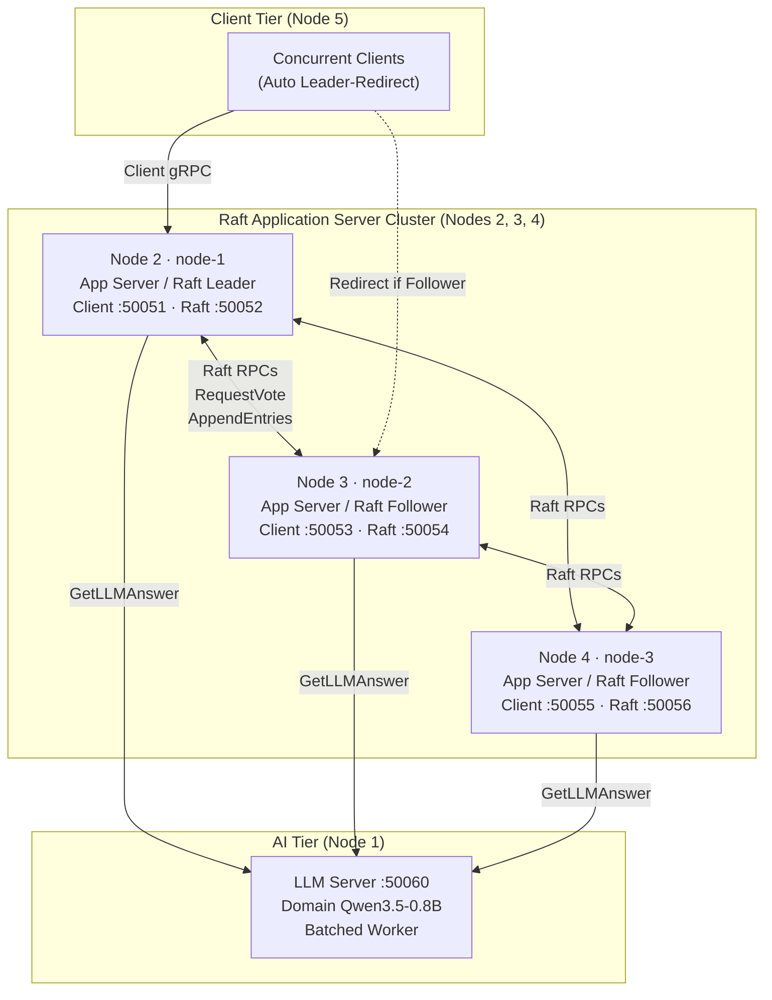
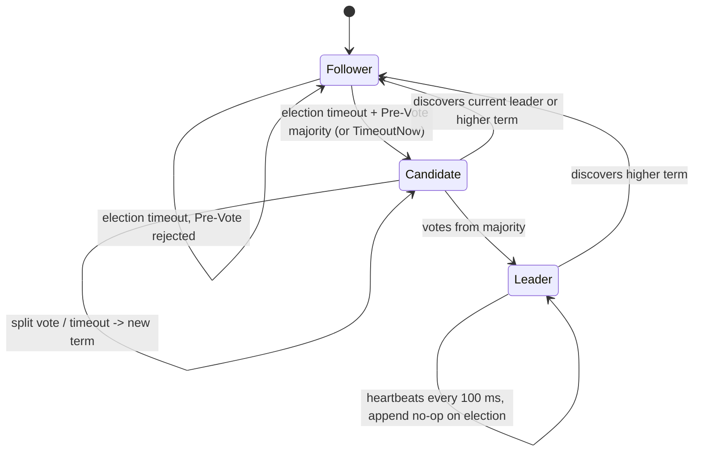
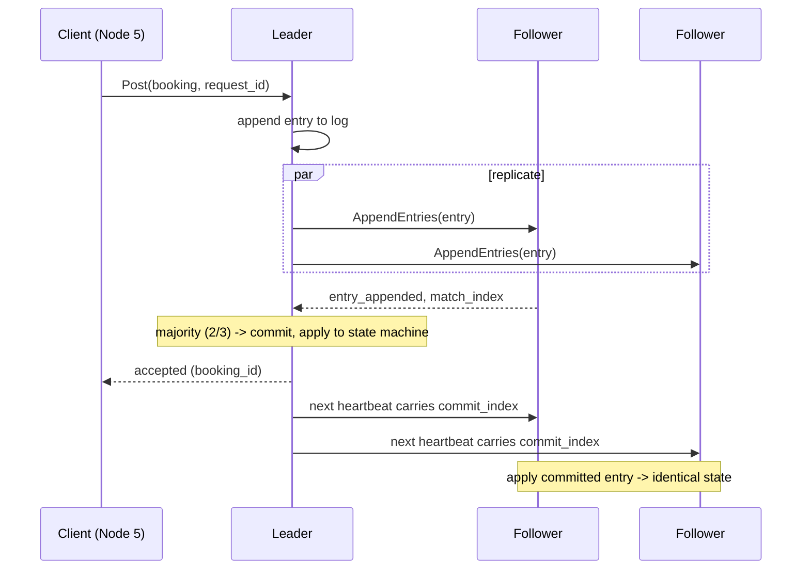
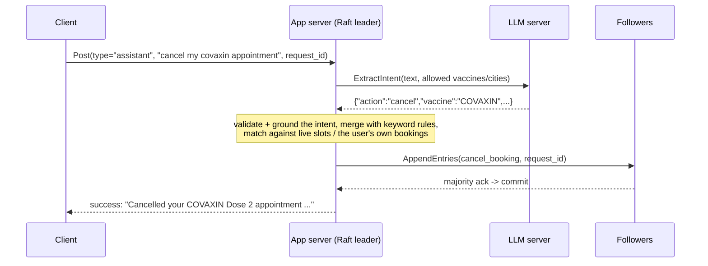

# Distributed Ticket Booking System

**CS G623 Advanced Operating Systems · BITS Pilani · Semester I 2026–27**
Architecture A (Distributed Ticket Booking), instantiated as a **distributed vaccine-slot booking platform**.
**Status: Milestone 1 & Milestone 2 (Raft Consensus & Fault Tolerance) COMPLETE.**

A gRPC-based, multi-node distributed booking system in Python implementing the **Raft Consensus Protocol** (Ongaro & Ousterhout). The system replicates state across a cluster of application server nodes, provides strong consistency for bookings and sessions, automatically elects a new leader upon node failure, supports adding/removing servers at runtime, and integrates a domain-specific LLM service (`Qwen3.5-0.8B` on CUDA/Apple MPS, with keyword fallback) running on an independent node — used both as an FAQ chatbot and to **book and cancel appointments from plain-English requests**.

---

## Contents

**[▶ One-command Quick Start (Windows / macOS / Linux)](#quick-start-one-command-on-windows-macos-or-linux)** · **[Manual 5-terminal steps](#run-the-demo-in-5-terminals-step-by-step)** · [Milestones Deliverables](#milestones-deliverables) · [Raft Paper Coverage](#raft-paper-coverage) · [Assignment Requirements Coverage](#assignment-requirements-coverage) · [Architecture](#architecture) · [Demo Topology](#demo-topology-5-nodes) · [Raft Consensus Implementation](#raft-consensus-implementation) · [gRPC Contract](#grpc-contract) · [Quick Start & Setup](#quick-start--setup) · [Running the Demos](#running-the-demos) · [Natural-Language Booking](#natural-language-booking-assistant) · [Cluster Administration](#cluster-administration) · [Multi-Machine Deployment](#multi-machine-deployment) · [Testing](#testing) · [Project Structure](#project-structure)

---

## Quick Start: one command on Windows, macOS or Linux

**Requirements:** Python 3.10 or newer, an internet connection for the first run (about 2–3 GB: PyTorch and the 1.6 GB LLM, downloaded once), and a desktop terminal. Nothing else; the launcher installs the rest into its own private folder (`.demo_venv`) and never touches your existing Python packages.

| Your system | Run this (from the project folder) |
|---|---|
| **Windows** | double-click **`run_demo.bat`**, or in cmd / PowerShell: `run_demo.bat` |
| **macOS** | double-click **`run_demo.command`**, or: `bash run_demo.sh` |
| **Linux** | `bash run_demo.sh` |

It then:
1. **Picks a Python:** the project's own `.demo_venv` if it already exists (a broken one is recreated); otherwise any Python 3.10+ on the computer: PATH, Homebrew, python.org, pyenv, conda/miniforge environments, and on Windows the `py` launcher and standard install folders (3.11/3.12 preferred); if there is **none at all**, it downloads a private Python 3.11 into `.demo_tools` with [uv](https://docs.astral.sh/uv/) (no admin rights, nothing installed system-wide). It never stops just because Python is missing.
2. Creates `.demo_venv` and installs the requirements into it. **Your own environments are never modified:** any Python, venv or conda env it finds is only *read* to create `.demo_venv`. Active-venv, `PYTHONPATH`, `PIP_*` and `pip.conf` settings are ignored during the install, and only a folder that really is a virtual environment is ever deleted and recreated. To remove every trace, delete `.demo_venv`, `.demo_tools` and `.demo`. (The LLM model is stored in the standard Hugging Face cache, `~/.cache/huggingface`, so it is shared with other projects instead of being downloaded twice.)
3. Downloads the LLM.
4. **Opens five terminal windows and starts one process in each**:

| Window | Runs |
|---|---|
| **T1 LLM server** | `scripts/run_llm_server.py` |
| **T2 / T3 / T4 Raft nodes** | `scripts/run_node.py` for `node-1`, `node-2`, `node-3` |
| **T5 client** | waits for the leader election, then runs `scripts/client_demo.py`; afterwards the window is an interactive shell ready for the commands in Steps 4–6 below |

The second start is fast (nothing to install). Every window stays open when its process ends and prints the command to start it again.

Options (append to the command): `--no-llm` skips PyTorch and the model and the LLM window (small install, FAQs then use keyword rules) · `--keep` keeps data from a previous run · `--background` opens no windows: everything runs hidden, logs go to `.demo/logs`, and the client walkthrough prints in the current terminal (also used automatically over SSH or without a display) · `python scripts/demo_launcher.py stop` stops a `--background` run.

Tested: macOS (clean install into a fresh venv, windows launch and background mode). The Windows and Linux paths use only standard OS mechanisms (`cmd /k` consoles; `gnome-terminal`, `konsole`, `xfce4-terminal`, `kitty`, `alacritty`, `xterm` and others) and fall back to `--background` if no terminal can be opened.

| Problem | Fix |
|---|---|
| "Could not download Python automatically" | Only happens without internet on a computer with no Python 3.10+: install it from python.org (Windows: tick *Add python.exe to PATH*); Debian/Ubuntu: `sudo apt install python3 python3-venv python3-pip` |
| "Port(s) … are already in use" | An earlier demo is still running: close its windows (or `python scripts/demo_launcher.py stop`) |
| PyTorch or the model cannot be downloaded | The demo still works; run again with `--no-llm`, or fix the connection and run `python scripts/demo_launcher.py setup --reinstall` |
| macOS asks "Terminal wants to control…" | Click OK once; it is only used to open the five windows |

The rest of this section explains the same demo started **by hand**, one terminal at a time.

## Run the Demo in 5 Terminals (step by step)

The system runs as **five separate processes, one per terminal**, matching the assignment's 5-node layout. Every terminal prints what its node is doing, so you can watch the whole system work.

| Terminal | Assignment node | Role |
|---|---|---|
| **T1** | Node 1 | AI / LLM server (Qwen3.5-0.8B) |
| **T2** | Node 2 | App server + Raft node `node-1` (client port 50051) |
| **T3** | Node 3 | App server + Raft node `node-2` (client port 50053) |
| **T4** | Node 4 | App server + Raft node `node-3` (client port 50055) |
| **T5** | Node 5 | Client node (users, load generator, chat assistant) |

Which of T2–T4 becomes leader is decided by the Raft election; it is shown in every node's `STATUS` line.

### Step 0 — in **each** of the 5 terminals

```bash
cd Distributed_TicketBooking          # the project folder
```
then activate an environment that has the requirements (the one-command launcher already created `.demo_venv`; otherwise see [Installation](#installation)):

| System | Activate |
|---|---|
| macOS / Linux | `source .demo_venv/bin/activate` |
| Windows cmd | `.demo_venv\Scripts\activate.bat` |
| Windows PowerShell | `.demo_venv\Scripts\Activate.ps1` |
| conda | `conda activate AOS` |

First time only, in one terminal: `pip install -r requirements.txt` (nothing else is needed; the scripts find the code themselves). On Windows set `PYTHONUTF8=1` if symbols such as ★ look garbled (`set PYTHONUTF8=1` in cmd).

> Instead of Steps 1–3 you can simply run the one-command launcher above; it does exactly these steps.

### Step 1 — T1: start the LLM server (wait for the banner, ~10 s)

```bash
python scripts/run_llm_server.py
```
```
==============================================================================
  AI / LLM SERVER   model=Qwen/Qwen3.5-0.8B on mps
  listening on :50060  (GetLLMAnswer for FAQs, ExtractIntent for plain-English bookings)
==============================================================================
```

### Step 2 — T2, T3, T4: start the three Raft nodes (one command per terminal)

**T2**
```bash
python scripts/run_node.py --node-id node-1 --client-port 50051 --raft-port 50052 --peers node-2:localhost:50054:50053,node-3:localhost:50056:50055 --fresh
```
**T3**
```bash
python scripts/run_node.py --node-id node-2 --client-port 50053 --raft-port 50054 --peers node-1:localhost:50052:50051,node-3:localhost:50056:50055 --fresh
```
**T4**
```bash
python scripts/run_node.py --node-id node-3 --client-port 50055 --raft-port 50056 --peers node-1:localhost:50052:50051,node-2:localhost:50054:50053 --fresh
```

`--fresh` deletes data from earlier runs so the demo starts clean. **Use it only for this first start.** Within a second of the second node starting, one terminal shows the election result:

```
21:20:49  [node-2] Starting election for term 1 (lastLogIndex=-1, lastLogTerm=0)
21:20:49  [node-2] ★ BECAME LEADER for term 1 (log_len=0)
21:20:49  [node-2] COMMITTED #0: no-op of the term-1 leader (confirms all earlier entries)
21:20:53  [node-2] STATUS  ★ LEADER   term=1  leader=self  commit=0  log=1  state=ff091ba0eb  members=node-1,node-2,node-3
```
and the other two show `Voted for node-2 in term 1` and `STATUS  follower ... leader=node-2`.

How to read a node terminal:

| Line | Meaning |
|---|---|
| `STATUS ★ LEADER / follower` | Printed every 5 s when something changed: role, term, current leader, commit index, log length, **`state=` hash of the booking data** (equal on all nodes ⇒ identical replicas), members |
| `Starting election`, `★ BECAME LEADER`, `Voted for` | Leader election (Raft §5.2) |
| `Pre-vote for term N failed` | A node checked whether it could win and could not, so it did not disturb the cluster |
| `COMMITTED #12: BOOK SLOT-… for user 'alice' -> ACCEPTED (booking APPT-…)` | A booking reached a majority and was applied. **The same line appears in all three node terminals** — that is log replication |
| `FAQ user 'alice': … (LLM)` / `ASSIST user 'alice': … -> understood [...]` | The leader served an FAQ or a plain-English request |
| `Snapshot taken at index 199` | Log compaction (Raft §7) |

### Step 3 — T5: walk through every client function

```bash
python scripts/client_demo.py
```
It calls `login → get(availability) → get(faq) → post(booking) → post(assistant, plain English) → get(my_bookings) → post(cancel) → logout`, prints a readable result for each step and which node served it. Meanwhile T1 prints each LLM question and answer, and T2–T4 print the matching `COMMITTED` lines.

### Step 4 — T5: concurrent users + kill the leader (fault tolerance)

```bash
python scripts/run_clients.py --users 5 --duration 60 --think 1 --faq
```
While it runs (about 60 s):
1. Find the terminal whose `STATUS` says `★ LEADER` and press **Ctrl+C** there (the leader crashes).
2. Within ~1–2 s one of the other two node terminals prints `Starting election` → `★ BECAME LEADER for term 2`. T5 keeps going: the clients find the new leader by themselves.
3. In the stopped terminal press **↑ then Enter** to run the **same command again — remove `--fresh`** so the node keeps its data. It prints `recovered from disk: term …, N committed entries replayed`, rejoins as a follower and catches up.
4. When `run_clients.py` ends it prints per-operation statistics and the consistency audit; it must end with **`AUDIT PASSED: no overbooking, no lost updates`**. The three `STATUS` lines show the same `commit=` and the same `state=` hash.

### Step 5 — T5: book and cancel in plain English (LLM)

```bash
python scripts/assistant.py --user asha
```
```
you> I want the corbevax booster in Bengaluru
you> how many covishield slots are left in Delhi?
you> bookings
you> cancel my corbevax appointment
you> quit
```
T1 shows the intent the model extracted (`intent (2.0s): {"action": "book", ...}`), the leader shows `ASSIST ... -> understood [...] -> BOOK`, and all nodes show the `COMMITTED` line.

### Step 6 (optional) — T5: cluster administration and live dashboard

```bash
python scripts/cluster_admin.py status            # every node's role, term, commit and members
python scripts/cluster_admin.py transfer          # planned leadership handover (watch T2–T4)
python scripts/monitor_cluster.py                 # live dashboard (Ctrl+C to exit)
```

### Stopping
Press **Ctrl+C** in each terminal.

### Troubleshooting
| Message | Fix |
|---|---|
| `ERROR: client port 50051 is already in use` | That node is still running in another terminal (or an old run is still alive): stop it first. |
| `Cannot reach the cluster` (T5) | Start T2–T4 first. |
| `... starts at entry N but the snapshot only covers up to ...` | Saved data is damaged or partly deleted: start that node once with `--fresh`; it re-syncs from the leader. |
| First FAQ answer takes ~3–10 s | The model is generating on CPU/MPS. If it is too slow the node answers from keyword rules and says `(keyword fallback …)`. |
| `conda: command not found` | Use the virtual-environment setup from [Quick Start & Setup](#quick-start--setup). |

Running on **5 separate machines** instead: see [Multi-Machine Deployment](#multi-machine-deployment) (same commands with real IP addresses).

---

## Milestones Deliverables

| Deliverable | Description / Location | Status |
|---|---|---|
| **gRPC Service Architecture** | `proto/ticket_service.proto`: `TicketClientService`, `TicketAppService`, `LLMService`, `RaftService` | ✅ Complete |
| **Authentication & Replicated Sessions** | Salted PBKDF2 password check run by the replicated state machine (plain-text passwords never enter the Raft log); sessions replicated via Raft; seamless client redirection on leader change | ✅ Complete |
| **Domain-specific AI / LLM Server** | Independent CPU-friendly node (`llm/domain_llm.py`, `scripts/run_llm_server.py`) | ✅ Complete |
| **Raft Consensus Algorithm** | Complete implementation (`src/dist_ticket_booking/raft/`): Leader Election, Log Replication, Commit advancement | ✅ Complete |
| **Distributed Data Consistency** | Strong consistency: bookings & cancellations commit only after majority replication | ✅ Complete |
| **Crash Recovery & Persistence** | `current_term`, `voted_for` and the log are written atomically (temp file + `fsync` + rename) before any reply, so a `SIGKILL` mid-write can never lose an acknowledged entry; corrupt state refuses to start | ✅ Complete |
| **Fault Tolerance & Leader Failure** | Automatic heartbeat failure detection, leader re-election, zero data loss (`scripts/demo_fault_tolerance.py`) | ✅ Complete |
| **Multi-Node Cluster Orchestration** | `scripts/run_cluster.py --nodes N` (3 or 5 nodes; tolerates ⌊(N−1)/2⌋ failures) | ✅ Complete |
| **Quorum-Loss Handling** | Leader cut off from the majority rejects writes immediately with a clear `unavailable` error (CheckQuorum) | ✅ Complete |
| **Network-Partition Safety** | An isolated leader that still believes it leads refuses reads and writes (read lease + CheckQuorum); the majority elects a new leader and keeps booking; replicas converge after healing (`tests/test_raft_safety.py`) | ✅ Complete |
| **Stress Testing** | 40 concurrent clients on one slot, leader crash under load, cancel-after-failover (`tests/test_raft_stress.py`) | ✅ Complete |
| **Cluster Membership Changes** | Add or remove a server at runtime through a Raft configuration entry, one server at a time (Raft §6, thesis §4.1); new nodes join as non-voters, a removed leader steps down (`scripts/cluster_admin.py`) | ✅ Complete |
| **Leadership Transfer** | Hand leadership to a chosen follower for planned maintenance via `TimeoutNow` (thesis §3.10) | ✅ Complete |
| **Natural-Language Booking (LLM)** | "book me a second COVAXIN dose in Mumbai" / "cancel my covaxin appointment": the LLM extracts the intent, the app server validates it against live replicated data and commits it through Raft (`scripts/assistant.py`) | ✅ Complete |
| **End-to-End Verification** | 49 live checks: LLM FAQ and natural-language booking, failover, quorum loss, full restart, 5 nodes, log compaction, membership change, leadership transfer (`scripts/verify_milestone2.py`) | ✅ Complete |
| **5-Node Demo Topology** | LLM node + 3 Raft nodes + client node with leader kill under load (`scripts/demo_full_system.py`) | ✅ Complete |
| **Client Node (Node 5)** | Concurrent user simulator with stats and a consistency audit (`scripts/run_clients.py`) | ✅ Complete |

**Extras beyond the minimum requirements**

| Extra | Description |
|---|---|
| **Log compaction + `InstallSnapshot` RPC** | Automatic snapshots every 200 entries (`--snapshot-threshold`); lagging followers catch up from the leader's snapshot (Raft §7) |
| **Exactly-once writes** | Every booking/cancel carries a `request_id`; the replicated state machine de-duplicates retries (Raft §8) |
| **Linearizable reads** | New leaders commit a no-op before serving reads (Raft §8), and serve reads only while holding a **leader lease**: a majority acknowledged a heartbeat within the minimum election timeout (Raft thesis §6.4.1) |
| **Pre-Vote** | A node asks "would you vote for me?" before incrementing its term (thesis §9.6), so a node cut off by a partition cannot inflate its term and force a needless election when it reconnects |
| **Disruptive-server protection** | Followers ignore `RequestVote` while they still hear from a live leader (Raft thesis §4.2.3), so a flaky or partitioned node cannot depose a healthy leader |
| **Partition fault injection** | `RaftNode.set_partition([...])` drops Raft RPCs between chosen nodes without killing processes, used by the partition tests |
| **CheckQuorum fail-fast** | Leaders cut off from the majority reject requests instantly with a clear error |
| **Replica state digest** | Every node reports a hash of its state; the monitor flags `IDENTICAL` vs `DIVERGED` replicas |
| **LLM grounding + back-pressure** | Policy-fact guardrail, live-context focusing, bounded in-flight LLM calls with keyword fallback |
| **Live cluster monitor** | `scripts/monitor_cluster.py`: role, term, commit/applied index, log size, state digest, LLM status |

---

## Raft Paper Coverage

Section-by-section against *In Search of an Understandable Consensus Algorithm (Extended Version)*, plus the extensions from Ongaro's PhD thesis that the paper refers to.

| Paper section | What it requires | Where / how | Tested in |
|---|---|---|---|
| §5.1 Basics | Follower/candidate/leader roles, terms, stepping down on a higher term | `RaftNode` states, `_step_down` | `test_raft_unit.py` |
| §5.2 Leader election | Randomized election timeouts, `RequestVote`, majority wins, heartbeats | 600–1200 ms timeouts, 100 ms heartbeats; leader takes office as soon as a majority votes | `test_raft_integration.py`, `verify` §2–3 |
| §5.3 Log replication | `AppendEntries` consistency check, conflict truncation, `nextIndex` back-off | `handle_append_entries`; follower returns its last index so the leader skips back in one step | `test_raft_safety.py::test_follower_truncates_conflicting_suffix` |
| §5.4.1 Election restriction | Vote only for candidates whose log is at least as up to date | `handle_request_vote` (`candidate_log_ok`) | `test_raft_unit.py` |
| §5.4.2 Committing earlier-term entries | Commit only entries of the current term by counting | `_try_advance_commit_index` + a no-op on election | `test_raft_unit.py`, `verify` §2 |
| §5.5 Follower/candidate crashes | Idempotent retries | Heartbeats resend missing entries; state machine is idempotent | `test_raft_stress.py` |
| §5.6 Timing | broadcastTime ≪ electionTimeout ≪ MTBF | ~1 ms RPCs, 100 ms heartbeats, 600–1200 ms timeouts | failover ≈ 1 s in `demo_full_system.py` |
| Fig. 2 persistent state | `currentTerm`, `votedFor`, `log[]` on stable storage before replying | Atomic temp-file + `fsync` + rename (`raft/storage.py`) | `test_raft_safety.py` |
| §6 Cluster membership changes | Change the configuration without two leaders in one term | Configuration stored as a log entry, used as soon as appended; **one server at a time** (thesis §4.1, see note); joiners are non-voting; removed leader steps down after commit; membership kept in snapshots | `test_raft_membership.py`, `verify` §5 |
| §7 Log compaction | Snapshots, `InstallSnapshot` | Snapshot every 200 entries; `InstallSnapshot` carries state + membership | `test_raft_unit.py`, `verify` §4 |
| §8 Client interaction | Find the leader, linearizable writes (no duplicates), no stale reads | Redirect hints; `request_id` de-duplication; no-op + **leader lease** before reads | `test_raft_unit.py`, `test_raft_safety.py`, `test_nl_assistant.py` |
| Thesis §3.10 | Leadership transfer | `TimeoutNow` RPC, `cluster_admin.py transfer` | `test_raft_membership.py`, `verify` §5 |
| Thesis §4.2.3 / §9.6 | Disruptive servers, Pre-Vote | Followers ignore votes while a leader is alive; Pre-Vote round before every election | `test_raft_membership.py`, `test_raft_safety.py` |

**Design choices that differ from the paper (deliberately):**
- **Membership:** the paper (§6) describes *joint consensus* (C_old,new), which allows changing many servers at once. We implement the *single-server* method from Ongaro's thesis §4.1, which the thesis recommends as simpler: adding or removing one server at a time guarantees that every majority of the old configuration overlaps every majority of the new one, so the same safety holds without a joint phase. Larger changes are done as a sequence of single steps.
- **Snapshots** are sent in one `InstallSnapshot` message rather than in chunks (`offset`/`done` in Figure 13); our booking state is a few kilobytes.
- **Joining servers** start replicating when they are added rather than in separate catch-up rounds beforehand (thesis §4.2.1); with three healthy members the 4-node majority (3) is still available while the newcomer catches up.

## Assignment Requirements Coverage

| Requirement (assignment PDF) | Where |
|---|---|
| Real-time seat reservation with concurrency control (M1) | Per-slot locks in `booking_service.py`; in the cluster every booking is a single Raft log entry applied in log order |
| Payment processing, mock (M1) | `_process_payment` in `booking_service.py` (paid CORBEVAX slot: ₹250) |
| LLM customer-support chatbot (M1) | `Get(type="faq")` → LLM server (`llm/domain_llm.py`) with live availability as context |
| Overbooking prevention through distributed consistency (M2) | Writes commit only on a majority; 40-client race test; client-node consistency audit |
| Booking state replication using Raft (M2) | `raft/` package; `StateMachine` applies committed entries on every node |
| Fault tolerance and recovery on leader/follower failure (M2) | `demo_fault_tolerance.py`, `demo_full_system.py`, `verify` §2–5 |
| gRPC for all inter-service communication; Python only | `proto/ticket_service.proto`; client↔app, app↔LLM, node↔node are all gRPC |
| Leader election, log replication, failure detection | See Raft paper coverage above |
| LLM on a separate server, CPU-friendly, domain-specific, context-aware | `scripts/run_llm_server.py` (Qwen3.5-0.8B, CPU/MPS/CUDA), live Raft data in every prompt |
| 4–5 node demo (LLM, leader, 2 followers, client node) | `scripts/demo_full_system.py` |
| `login`, `logout`, `post`, `get` | `TicketClientService` (`Login`, `Logout`, `Post`, `Get`) |
| `processBusinessRequest`, `getLLMAnswer` | `TicketAppService.ProcessBusinessRequest`, `LLMService.GetLLMAnswer` |
| `requestVote` / `requestVoteReply`, `appendEntries` / `appendEntriesReply` | `RaftService.RequestVote` / `AppendEntries` with exactly the listed fields (`from, to, term, lastLogIndex, lastLogTerm, prevIndex, prevTerm, commitIndex, entries, voteGranted, entryAppended, matchIndex`) |
| Stress testing | `tests/test_raft_stress.py`, `scripts/run_clients.py` |
| README, reflection document, zip | `README.md`, `REFLECTION_DOCUMENT.md`, `scripts/package_submission.sh` |

---

## Architecture



---

## Demo Topology (5 nodes)

The assignment's suggested layout, as run by `scripts/demo_full_system.py` (one machine) or by the per-machine commands in [Multi-Machine Deployment](#multi-machine-deployment):

| Assignment node | Role | Process | Ports |
|---|---|---|---|
| **Node 1** | AI/LLM server (Qwen3.5-0.8B), independent | `scripts/run_llm_server.py` | `:50060` |
| **Node 2** | App server + Raft (initial leader) | `run_node.py --node-id node-1` | client `:50051` · raft `:50052` |
| **Node 3** | App server + Raft follower | `run_node.py --node-id node-2` | client `:50053` · raft `:50054` |
| **Node 4** | App server + Raft follower (redundancy) | `run_node.py --node-id node-3` | client `:50055` · raft `:50056` |
| **Node 5** | Client node: many concurrent users | `scripts/run_clients.py` | — |

Leadership is decided by Raft, so whichever app node wins the first election plays "Node 2". Any app node can be killed; the other two keep serving.

---

## Raft Consensus Implementation

The consensus engine is implemented from the ground up in `src/dist_ticket_booking/raft/`:

1. **Leader Election (`RaftNode`)**:
   - Nodes transition between `FOLLOWER`, `CANDIDATE`, and `LEADER`.
   - Randomized election timeouts (600–1200 ms, heartbeat 100 ms) prevent split votes; the range is wider than the paper's 150–300 ms so Python process stalls do not trigger spurious elections.
   - Candidates solicit votes via `RequestVote` RPCs; win leadership upon securing a majority ($\lfloor N/2 \rfloor + 1$).
   - **Pre-Vote**: before incrementing its term a node first asks the others whether they would vote for it; only with a majority of "yes" does it start a real election. Nodes still hearing from a live leader say no.
2. **Log Replication**:
   - The Leader accepts client requests via `propose(command_type, command)`.
   - Commands are appended to the local log and replicated via `AppendEntries` RPCs.
   - Once acknowledged by a majority, the Leader increments `commit_index` and applies the entry to the `StateMachine`.
3. **State Machine (`StateMachine`)**:
   - Applies committed log entries to the `BookingService` (slot inventory, appointment records) and session store.
   - Guarantees deterministic convergence across all surviving nodes. Booking IDs are derived from the log index, so every replica assigns the same ID (cancellations keep working after failover).
4. **Crash Recovery & Persistence (`RaftLog`, `storage.py`)**:
   - `current_term`, `voted_for`, and the complete `log` are persisted before the node replies. Every write goes to a temporary file, is `fsync`-ed and atomically renamed, so a crash leaves either the old or the new file, never a half-written one. A follower stores a whole `AppendEntries` batch with one write.
   - Upon reboot, a crashed node reloads its state, replays committed log entries, reconnects to the cluster, and synchronizes missing entries with the active Leader.
5. **Commit-safe recovery**:
   - `commit_index` is persisted as a lower bound; on restart a node replays only entries known to be committed. Uncommitted leftovers are applied only once a leader's commit index covers them (they may be overwritten).
   - A new leader appends a **no-op** entry in its own term; committing it commits all earlier entries (Raft §5.4.2), and the leader serves reads only after that (read barrier).
   - A node casts at most one vote per term (`votedFor` is only reset when the term increases).
6. **Log compaction (`InstallSnapshot`)**:
   - After `--snapshot-threshold` entries (default 200) a node snapshots its state machine (point-in-time deep copy) and discards the compacted log prefix.
   - If a follower needs entries the leader has compacted, the leader sends its snapshot via the `InstallSnapshot` RPC; the follower installs it and continues with normal `AppendEntries`.
7. **Quorum checks & client behaviour**:
   - The leader tracks the last acknowledgement from each follower; without a recent majority it rejects requests at once (`status="unavailable"`, "no quorum") instead of blocking.
   - `TicketClient` follows leader redirects and rides out elections: it backs off while no leader is known, and rotates through its seed nodes if the node it talks to is unreachable.
   - **Partitions**: a leader on the minority side of a network partition cannot renew its lease, so it answers `unavailable` instead of serving stale seat counts; clients that know several nodes move on to one that can reach the real leader. When the partition heals, the old leader sees the newer term and steps down.
   - **Leadership transfer**: on request the leader stops accepting writes, brings the chosen follower fully up to date, and sends it `TimeoutNow`; the follower wins the next election immediately.
   - **Exactly-once writes**: each booking/cancel carries a client-generated `request_id` that stays the same across retries. The state machine caches results by `request_id` (included in snapshots), so a retried write whose reply was lost in a crash returns the original result instead of being applied again.

8. **Cluster membership changes (Raft §6)**:
   - The configuration (members and their addresses) is an ordinary log entry of type `config`. Every node uses the newest configuration in its log as soon as it is appended, as the paper requires; majorities and commit counting use that configuration.
   - Changes are made **one server at a time** and only one may be in progress; a new leader must first commit its no-op (fixes the bug described in thesis §4.1).
   - A new node is started with `--join`: it replicates but never campaigns until a configuration that includes it reaches it. A leader that removes itself keeps leading until the change commits, then steps down.
   - Snapshots store the membership in force at the snapshot index, so it survives log compaction and restarts.





### LLM Integration (Node 1)
- Model: **Qwen/Qwen3.5-0.8B**, loaded offline from the HuggingFace cache; device auto-selected (CUDA → Apple MPS → CPU), thinking mode disabled. ~2–4 s per answer on MPS.
- **Context-aware**: the app server injects live, Raft-replicated slot availability (filtered to the vaccine/city asked about) into the prompt, plus the matching policy rule.
- **Grounding guardrail**: if the model drops or inverts a key policy number (e.g. the 24-hour cancellation deadline), the verified policy text is returned instead.
- **Natural-language booking**: see [below](#natural-language-booking-assistant).
- **Resilience**: app-server → LLM calls have a deadline (`LLM_TIMEOUT_S`, default 30 s); if the LLM node is down or too slow, a keyword-based answer is returned and bookings are unaffected.

---

## gRPC Contract

All communication occurs via gRPC as defined in `proto/ticket_service.proto`:

### Client & Application RPCs
- `Login(LoginRequest) -> LoginResponse`: Authenticates the user (first login registers the username; afterwards the same password is required) and replicates the session token via Raft.
- `Logout(LogoutRequest) -> StatusResponse`: Terminates session across cluster.
- `Post(PostRequest) -> StatusResponse`: Submits write operations (`booking`, `cancel`, and `assistant` for a natural-language request).
- `Get(GetRequest) -> GetResponse`: Queries read operations (`availability`, `my_bookings`, `faq`, `cluster_status`).
- `ProcessBusinessRequest(BusinessRequest) -> StatusResponse`: Inter-service business dispatch.
- `ChangeMembership(MembershipChangeRequest) -> StatusResponse`, `TransferLeadership(TransferLeadershipRequest) -> StatusResponse`: cluster administration.

### LLM RPCs
- `GetLLMAnswer(LLMQueryRequest) -> GetLLMAnswerResponse`: FAQ answer (`requestId, query, context` → `requestId, answer`).
- `ExtractIntent(LLMQueryRequest) -> GetLLMAnswerResponse`: JSON intent for a natural-language booking request.

### Raft Consensus RPCs
- `RequestVote(RequestVoteRequest) -> RequestVoteResponse`: Candidate leader election voting (`from, to, term, lastLogIndex, lastLogTerm` → `from, to, term, voteGranted`).
- `AppendEntries(AppendEntriesRequest) -> AppendEntriesResponse`: Leader log replication & heartbeat (`from, to, term, prevIndex, prevTerm, commitIndex, entries` → `from, to, term, entryAppended, matchIndex`).
- `InstallSnapshot(InstallSnapshotRequest) -> InstallSnapshotResponse`: Ships the leader's snapshot (and membership) to a follower behind the compacted log.
- `TimeoutNow(TimeoutNowRequest) -> TimeoutNowResponse`: Leadership transfer. `RequestVote` also carries `pre_vote` and `leadership_transfer` flags.

To regenerate stubs:
```bash
bash scripts/generate_grpc.sh
```

---

## Quick Start & Setup

### Requirements
- Python 3.10+ (recommended: conda environment `AOS` or standard virtual environment).

### Installation

```bash
# Using Conda:
conda activate AOS

# Or using standard venv (Python 3.10+ required; macOS system python3 is 3.9):
python3.11 -m venv .venv && source .venv/bin/activate

# Install dependencies and editable package:
pip install -r requirements.txt && pip install -e .   # pinned versions
# or: pip install -e ".[llm,test]"
```

---

## Running the Demos

### 1. Fault Tolerance & Leader Recovery Demo (Viva Demonstration)

Demonstrates the primary Milestone 2 requirements:
1. Boots a 3-node Raft cluster.
2. Books tickets through the elected Leader.
3. **Kills the Leader mid-operation (`SIGKILL`)**.
4. Surviving nodes detect heartbeat timeout and elect a **new Leader**.
5. Client seamlessly continues booking through the new Leader with **zero data loss**.
6. Crashed node is restarted, recovers state from disk, and catches up with the latest log entries!

```bash
python scripts/demo_fault_tolerance.py
```

### 2. Distributed Raft Replication & Follower Redirect Demo

Demonstrates multi-node replication and client transparent auto-redirect:

```bash
python scripts/demo_raft.py
```

### 3. Full 5-Node System Demo (recommended)

Starts the LLM node and 3 Raft nodes, runs the client node (20 concurrent users: bookings, cancels, availability, FAQ), **kills the leader at t=10 s under load**, restarts it at t=18 s, and finishes with the client's consistency audit and the cluster monitor (all replicas must show the same state digest):

```bash
python scripts/demo_full_system.py               # add --no-llm for Raft only
```

Run the client node on its own against any running cluster:
```bash
python scripts/run_clients.py --users 30 --duration 20 --faq
```

### 4. End-to-End Milestone 2 Verification

Starts real multi-process clusters and prints PASS/FAIL for 49 checks: LLM FAQ via leader/follower, natural-language booking and cancellation, live availability answers, concurrent queries, FAQ after leader kill, LLM-server outage, follower crash, quorum loss (fail-fast), quorum restore, full-cluster crash + recovery, a 5-node cluster surviving 2 failures, and log compaction with `InstallSnapshot` catch-up, leadership transfer, and growing the cluster 3 → 4 nodes and shrinking it back by removing the leader.

```bash
python scripts/verify_milestone2.py             # ~2 min, includes the LLM
python scripts/verify_milestone2.py --skip-llm  # Raft-only, faster
python scripts/run_all_demo.py                  # tests + all demos + verification + full system
```

### 5. Running a Cluster Interactively

To start the cluster (with the LLM server) and keep it running:

```bash
python scripts/run_cluster.py --nodes 3 --with-llm   # or --nodes 5
```

- **Node 1**: Client port `50051` · Raft port `50052`
- **Node 2**: Client port `50053` · Raft port `50054`
- **Node 3**: Client port `50055` · Raft port `50056`

Run client interactions against any node, and watch the cluster live:
```bash
python scripts/client_demo.py
python scripts/monitor_cluster.py              # --nodes 5 for a 5-node cluster
```

---

## Natural-Language Booking Assistant

Citizens can type what they want instead of slot IDs:

```bash
python scripts/run_cluster.py --nodes 3 --with-llm     # in one terminal
python scripts/assistant.py --user asha                 # interactive chat
python scripts/assistant.py --user asha "book me a COVAXIN second dose in Mumbai"
```

```
you> I want the corbevax booster in Bengaluru
assistant [✔ accepted]: Payment of ₹250 successful. Appointment confirmed at Fortis Hospital Bangalore for CORBEVAX Dose 3 on 2026-10-07. Booking ID: APPT-SLOT-CBX-BOS-asha-12.
you> cancel my appointment
assistant [? clarify]: You have several matching appointments: ... Which one should I cancel?
you> how do I cancel a booking?
assistant [✔ success]: Cancellation is allowed only up to 24 hours before your scheduled appointment...
```



**Why the LLM cannot do damage:** the model only *proposes* an interpretation; it never writes state.
- Every value it returns is checked: unknown vaccines/cities/doses and malformed JSON are dropped, and values the user never mentioned (a small model sometimes "fills in" a vaccine) are ignored.
- A sentence that reads as a question ("how do I cancel?") is answered, never executed, and an explicit cancellation can never become a booking.
- Bookings are only ever made for a real open slot and cancellations only for the caller's own confirmed booking. If several match, the assistant asks which one; if none match, it says why.
- The action is the same replicated `create_booking` / `cancel_booking` command as a normal request, so overbooking protection and exactly-once retries still apply — a retried sentence returns the original result.
- If the LLM server is down, a keyword extractor takes over.

## Cluster Administration

```bash
# start a 4th node that waits to be added (replicates, never campaigns)
python scripts/run_node.py --node-id node-4 --client-port 50057 --raft-port 50058 --join \
  --peers "node-1:localhost:50052:50051,node-2:localhost:50054:50053,node-3:localhost:50056:50055"

python scripts/cluster_admin.py add node-4 --raft-port 50058 --client-port 50057
python scripts/cluster_admin.py remove node-3        # one server at a time
python scripts/cluster_admin.py transfer node-2      # planned leadership handover
python scripts/cluster_admin.py status               # role, term and membership per node
```

---

## Multi-Machine Deployment

Every process binds to all interfaces and is addressed by `host:port`, so the same scripts run across separate machines. Example with the LLM on `10.0.0.1`, app nodes on `10.0.0.2–4` and the client node anywhere (peer format: `node-id:host:raft_port:client_port`):

```bash
# Node 1 (10.0.0.1): LLM server
python scripts/run_llm_server.py --port 50060

# Node 2 (10.0.0.2)
python scripts/run_node.py --node-id node-1 --host 10.0.0.2 --client-port 50051 --raft-port 50052 \
  --peers "node-2:10.0.0.3:50054:50053,node-3:10.0.0.4:50056:50055" --llm-host 10.0.0.1

# Node 3 (10.0.0.3)
python scripts/run_node.py --node-id node-2 --host 10.0.0.3 --client-port 50053 --raft-port 50054 \
  --peers "node-1:10.0.0.2:50052:50051,node-3:10.0.0.4:50056:50055" --llm-host 10.0.0.1

# Node 4 (10.0.0.4)
python scripts/run_node.py --node-id node-3 --host 10.0.0.4 --client-port 50055 --raft-port 50056 \
  --peers "node-1:10.0.0.2:50052:50051,node-2:10.0.0.3:50054:50053" --llm-host 10.0.0.1

# Node 5 (client machine): concurrent users + live monitor
python scripts/run_clients.py --nodes 10.0.0.2:50051,10.0.0.3:50053,10.0.0.4:50055 --users 30 --faq
python scripts/monitor_cluster.py --addrs 10.0.0.2:50051,10.0.0.3:50053,10.0.0.4:50055 --llm 10.0.0.1:50060
```

Open the client and Raft ports (and `50060` on the LLM machine) in the firewall. `--host` is the address other machines use to reach the node (recorded in membership-change entries). Leader redirects use the addresses given in `--peers`, so use addresses the client machine can reach. These exact commands were smoke-tested with `127.0.0.1` as every host.

**Tuning (environment variables):** `RAFT_LOG_LEVEL` (default `INFO`), `LLM_TIMEOUT_S` (default `30`), `LLM_MAX_INFLIGHT` (default `4` concurrent LLM calls per app node).

---

## Testing

Run the automated test suite (60 tests covering contracts, business logic, gRPC, Raft units, 3-node cluster integration, stress, partition safety, membership changes and the natural-language assistant):

```bash
pytest -v        # pytest config in pyproject.toml sets the paths
```

### Test Breakdown
| Test Suite | Purpose | Tests |
|---|---|---|
| `tests/test_raft_unit.py` | Log persistence, elections, one-vote-per-term, append entries & match index safety, commit-safe restart, snapshots & `InstallSnapshot`, exactly-once dedupe | 14 |
| `tests/test_raft_integration.py` | 3-node live gRPC cluster, leader election, replicated bookings, follower redirect | 3 |
| `tests/test_raft_stress.py` | 40-client race (no overbooking), leader crash under load, cancel after failover, no-quorum fail-fast | 4 |
| `tests/test_raft_safety.py` | Partitioned leader never serves stale data, minority follower cannot disrupt, vote-ignore rule, conflict truncation, atomic/corrupt storage, crash between snapshot and log rewrite, password checks on every replica | 8 |
| `tests/test_raft_membership.py` | Add/remove servers (3 → 4 → 3, removing the leader), membership after restart + snapshot, leadership transfer, Pre-Vote | 4 |
| `tests/test_nl_assistant.py` | Intent extraction, validation of model output, ignoring invented values, question/cancel safety, ambiguity handling, end-to-end NL booking + cancel through Raft with retry | 6 |
| `tests/test_contracts.py` | Data model contracts and logical lock manager | 4 |
| `tests/test_business_and_grpc_contracts.py` | Validation, inventory, dispatcher, LLM fallback/grounding, live-context focus | 15 |
| `tests/test_grpc_integration.py` | Full client workflow, concurrency race prevention | 2 |
| **Total** | | **60 / 60 Passed** |

---

## Packaging the Submission

```bash
bash scripts/package_submission.sh   # zips every git-tracked file into Distributed_TicketBooking_Submission.zip
```

---

## Project Structure

```
run_demo.bat / run_demo.sh / run_demo.command   One-command demo for Windows / Linux, macOS / macOS double-click
proto/
  ticket_service.proto                gRPC services (Client, App, LLM, Raft)
src/dist_ticket_booking/
  raft/
    config.py                         ClusterConfig, PeerInfo and current membership
    log.py                            RaftLog and LogEntry with JSON persistence and compaction
    storage.py                        Atomic, fsync-ed writes for Raft stable storage
    state_machine.py                  StateMachine applying committed log commands
    node.py                           Core RaftNode engine (elections + Pre-Vote, replication, membership, transfer)
  business/
    booking_service.py                Vaccine slot inventory, booking logic, per-slot locks
  coordination/
    lock_manager.py                   Logical lock ownership tracker
  scheduler/
    dispatcher.py                     FIFO booking dispatcher queue
  core/
    models.py                         Dataclasses (VaccineSlot, Appointment, ...)
    auth.py                           Salted PBKDF2 password digests
  grpc/
    raft_service.py                   RaftServiceServicer (RequestVote, AppendEntries, InstallSnapshot, TimeoutNow)
    service.py                        TicketClientServicer, TicketAppServicer, TicketClient
    ticket_service_pb2*.py            Compiled protobuf & gRPC stubs
  llm/
    domain_llm.py                     Standalone domain Qwen3.5-0.8B model (FAQ + intent extraction) / fallback
    intent.py                         Natural-language intent validation, grounding and resolution
scripts/
  run_node.py                         Single Raft node launcher
  run_cluster.py                      Multi-node cluster manager
  demo_raft.py                        Raft consensus replication walkthrough
  demo_fault_tolerance.py             Leader crash, election, and recovery demonstration
  verify_milestone2.py                End-to-end Milestone 2 checks (LLM, quorum, restart, 5 nodes, snapshots)
  demo_full_system.py                 5-node demo: LLM + 3 Raft nodes + client node, leader kill under load
  run_clients.py                      Client node: concurrent users, stats, consistency audit
  ask.py                              Ask the FAQ assistant one question (live demo helper)
  assistant.py                        Natural-language booking/cancellation chat
  cluster_admin.py                    Add/remove servers, transfer leadership, cluster status
  run_llm_server.py                   Standalone LLM node (Qwen3.5-0.8B)
  monitor_cluster.py                  Live cluster status dashboard
  client_demo.py                      Step-by-step walkthrough of every client function
  demo_launcher.py                    Cross-platform: install, open the 5 terminals, run each (used by run_demo.*)
  demo_concurrency.py                 10-client concurrent race demo
tests/
  test_raft_unit.py                   Unit tests for Raft internals
  test_raft_integration.py            Integration tests for multi-node Raft
  test_raft_stress.py                 Stress / failover tests
  test_raft_safety.py                 Partition, persistence and authentication safety tests
  test_raft_membership.py             Membership change, leadership transfer, Pre-Vote tests
  test_nl_assistant.py                Natural-language booking assistant tests
  test_contracts.py                   Model contract tests
  test_business_and_grpc_contracts.py Business logic contract tests
  test_grpc_integration.py            gRPC integration tests
```

---

## Reference
Diego Ongaro and John Ousterhout. *"In Search of an Understandable Consensus Algorithm (Extended Version)"*, Stanford University.
