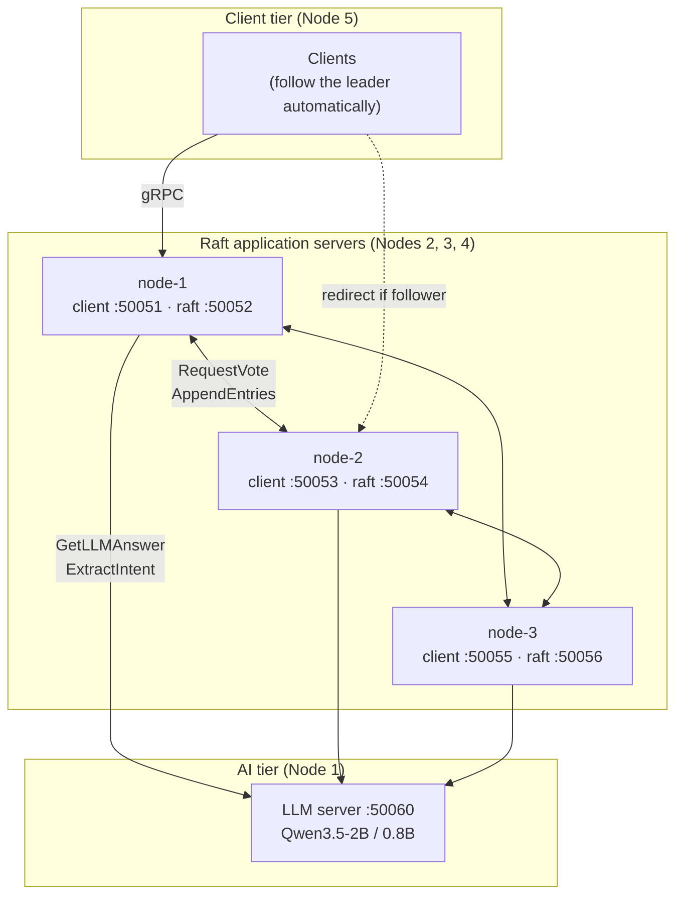
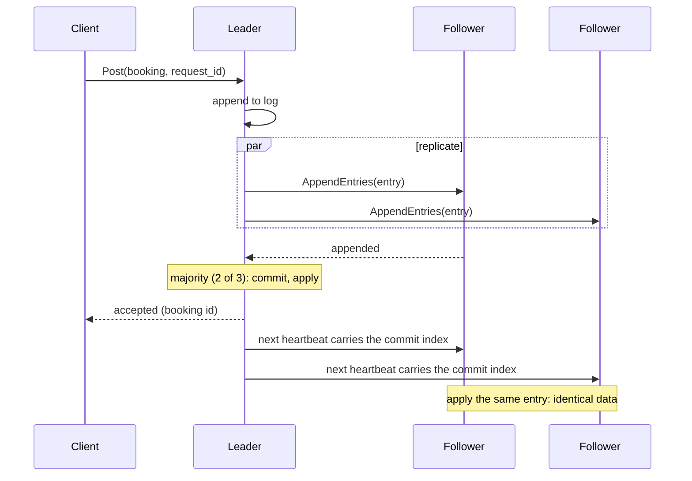
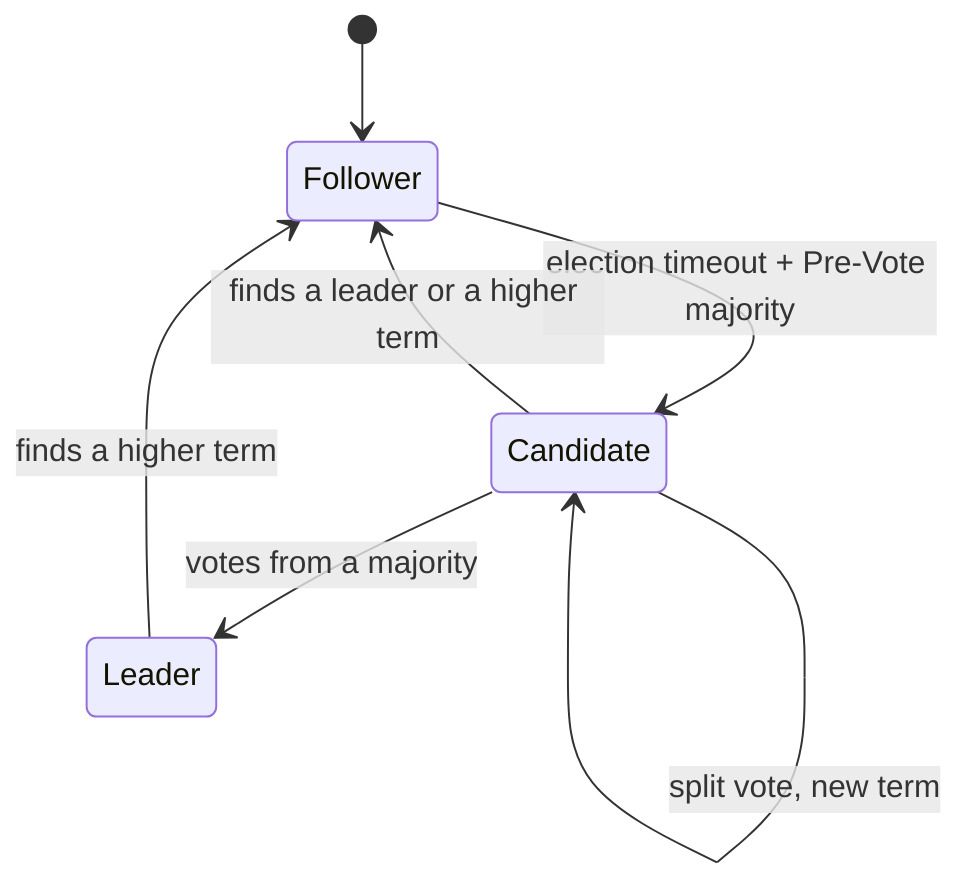

# Distributed Ticket Booking System

**CS G623 Advanced Operating Systems · BITS Pilani · Semester I 2026–27**
Architecture A (Distributed Ticket Booking), built as a **distributed vaccine-slot booking platform**.
**Status: Milestone 1 and Milestone 2 (Raft consensus and fault tolerance) complete.**

A multi-node booking system in Python. Three application servers keep the booking data identical with the **Raft consensus algorithm**, elect a new leader on their own when the leader crashes, and never overbook a slot. Everything talks over **gRPC**. A separate **LLM server** answers questions and turns plain English ("book a COVAXIN second dose in Mumbai") into real bookings.

---

## Contents

1. [Quick start: one click](#1-quick-start-one-click)
2. [Run it by hand: one terminal per node](#2-run-it-by-hand-one-terminal-per-node)
3. [Command reference](#3-command-reference)
4. [How it works](#4-how-it-works)
5. [Requirements coverage](#5-requirements-coverage)
6. [Running on several machines](#6-running-on-several-machines)
7. [Tests](#7-tests)
8. [Project structure](#8-project-structure)

---

## 1. Quick start: one click

You need **Python 3.10 or newer** and an internet connection on the first run. Nothing else: the launcher installs everything into its own folder (`.demo_venv`) and never changes your Python setup. If no Python 3.10+ is found, it downloads a private one.

| System | Do this in the project folder |
|---|---|
| **Windows** | double-click **`run_demo.bat`** |
| **macOS** | double-click **`run_demo.command`** (or run `bash run_demo.sh`) |
| **Linux** | run `bash run_demo.sh` |

The first run takes a few minutes: it installs PyTorch and downloads the language model once (Qwen3.5-2B, ~4.5 GB, on Apple Silicon or an NVIDIA GPU; Qwen3.5-0.8B, ~1.6 GB, otherwise). Later runs start in seconds. On a Windows/Linux machine with an NVIDIA GPU (driver supporting CUDA 12.6+), the launcher automatically installs the CUDA build of PyTorch (about 2.6 GB extra); without one it uses the normal CPU build.

**Five windows open, one per node:**

| Window | Node | What you see |
|---|---|---|
| **T1** | LLM server | every question and the model's answer |
| **T2, T3, T4** | Raft nodes `node-1`, `node-2`, `node-3` | `★ BECAME LEADER` in one of them; every booking appears as the same `COMMITTED #n` line in all three |
| **T5** | Client | runs everything automatically (see below), then stays open for your own commands |

**What T5 does, without any input from you:**

1. **Calls every client function in order:** login, availability, an FAQ answered by the LLM, a booking, a plain-English booking, my bookings, a cancel with refund, logout.
2. **Runs the automatic leader-failure test:**
   - 6 users keep booking and cancelling;
   - the leader process is **killed** (like a power cut);
   - the two survivors elect a new leader;
   - the crashed node restarts **in its own window** from its saved data and catches up;
   - a checklist is printed:

```
  [PASS] new leader elected by the survivors  (node-2 in term 2, 0.6s after the crash)
  [PASS] new term is higher than the crashed leader's  (term 1 -> 2)
  [PASS] clients kept working through the failover  (547 operations and 113 bookings after the crash, 0 client errors)
  [PASS] no overbooking and no lost updates (seat audit, every slot)  (161 bookings and 147 cancellations all accounted for)
  [PASS] crashed node node-1 recovered from disk and caught up as a follower  (commit 435)
  [PASS] all running replicas hold identical data (same state hash)  (3 nodes, hash 76b135a575)
  ALL 6 CHECKS PASSED: leader node-1 crashed, node-2 took over in 0.6s, no data lost
```

`COMMIT 435` is the number of entries in the Raft log. Every write is one entry: logins, bookings, cancellations and rejected booking attempts.

**Launcher options** (add them after the command, e.g. `bash run_demo.sh --no-llm`):

| Option | Effect |
|---|---|
| `--no-llm` | skip PyTorch, the model and the LLM window (small, fast install; questions are answered from the built-in policy text) |
| `--keep` | keep the booking data from the previous run instead of starting clean |
| `--background` | open no windows; everything runs hidden with logs in `.demo/logs` (used automatically over SSH) |
| `--background --once` | as above, print the whole walkthrough in this terminal, then stop |

Stop the demo by closing the windows, or with `python scripts/demo_launcher.py stop` for a `--background` run. To remove every trace, delete `.demo_venv`, `.demo_tools` and `.demo`.

**If something goes wrong:**

| Problem | Fix |
|---|---|
| "Port(s) … are already in use" | An earlier demo is still running: close its windows, or run `python scripts/demo_launcher.py stop` |
| PyTorch or the model cannot be downloaded | Run again with `--no-llm`, or fix the connection and run `python scripts/demo_launcher.py setup --reinstall` |
| "Could not download Python automatically" | No internet and no Python 3.10+: install Python from python.org (Windows: tick *Add python.exe to PATH*) |
| macOS asks "Terminal wants to control…" | Click OK once; it is only used to open the five windows |

---

## 2. Run it by hand: one terminal per node

The same system, started yourself: five terminals, one command each.

**Step 0: in every terminal**, go to the project folder and activate the environment:

| System | Command |
|---|---|
| macOS / Linux | `source .demo_venv/bin/activate` |
| Windows cmd | `.demo_venv\Scripts\activate.bat` |
| Windows PowerShell | `.demo_venv\Scripts\Activate.ps1` |

`.demo_venv` exists after one run of the [one-click launcher](#1-quick-start-one-click). Without it, use any Python 3.10+ environment and run `pip install -r requirements.txt` once.

**Step 1: start the five nodes**

| Terminal | Command |
|---|---|
| **T1** LLM server | `python scripts/run_llm_server.py` |
| **T2** node-1 | `python scripts/run_node.py --node-id node-1 --client-port 50051 --raft-port 50052 --peers node-2:localhost:50054:50053,node-3:localhost:50056:50055 --fresh` |
| **T3** node-2 | `python scripts/run_node.py --node-id node-2 --client-port 50053 --raft-port 50054 --peers node-1:localhost:50052:50051,node-3:localhost:50056:50055 --fresh` |
| **T4** node-3 | `python scripts/run_node.py --node-id node-3 --client-port 50055 --raft-port 50056 --peers node-1:localhost:50052:50051,node-2:localhost:50054:50053 --fresh` |
| **T5** client | `python scripts/client_demo.py` (walkthrough of every client function), then any command from [section 3](#3-command-reference) |

- **T1** is optional. Without it, questions are answered from the built-in policy text.
- **`--fresh`** wipes data from earlier runs. Use it **only on the first start**. To restart a crashed node with its data, run the same command **without** `--fresh`.

A second after the second node starts, one node wins the election:

```
21:20:49  [node-2] ★ BECAME LEADER for term 1 (log_len=0)
21:20:49  [node-2] COMMITTED #0: no-op of the term-1 leader (confirms all earlier entries)
21:20:53  [node-2] STATUS  ★ LEADER   term=1  leader=self  commit=0  log=1  state=ff091ba0eb  members=node-1,node-2,node-3
```

**How to read a node terminal:**

| Line | Meaning |
|---|---|
| `STATUS ★ LEADER` / `STATUS follower` | role, term, current leader, commit index, log length and **`state=` hash of the booking data**: the same hash on every node means identical copies |
| `Starting election`, `★ BECAME LEADER`, `Voted for` | leader election |
| `COMMITTED #12: BOOK SLOT-… for user 'alice' -> ACCEPTED` | a write reached a majority and was applied. **The same line appears on all three nodes**: that is replication |
| `FAQ …` / `ASSIST … -> understood […]` | the leader answered a question or a plain-English request |
| `Snapshot taken at index 199` | old log entries were compacted |
| `recovered from disk: …` | a restarted node reloaded its saved data |

Stop everything with **Ctrl+C** in each terminal.

---

## 3. Command reference

Run these in **T5** (with the environment activated). Every command can be pointed at any node: a follower forwards the client to the leader.

### Client: one action per command (`scripts/client.py`)

| # | Command | Expected result |
|---|---|---|
| 1 | `python scripts/client.py status` | one `* LEADER`, two `follower`s, same term, commit and state hash |
| 2 | `python scripts/client.py availability` | six slots with open seats and prices |
| 3 | `python scripts/client.py book SLOT-CVS-D1-110001` | `ACCEPTED`; the `COMMITTED` line appears in T2, T3 **and** T4 |
| 4 | `python scripts/client.py book SLOT-CVS-D1-500001` | `REJECTED`: one appointment per dose (Dose 1 is already booked, at another centre) |
| 5 | `python scripts/client.py book SLOT-CBX-BOS-560001 --pay card_declined` | `REJECTED`: payment declined, seat count unchanged |
| 6 | `python scripts/client.py book SLOT-CBX-BOS-560001 --pay card` | `ACCEPTED`: payment of ₹250 received |
| 7 | `python scripts/client.py my-bookings` | your appointments with their booking IDs |
| 8 | `python scripts/client.py cancel <booking id from 7>` | `SUCCESS`: seat released, any fee refunded |
| 9 | `python scripts/client.py faq "How do I cancel a booking?"` | the LLM's answer; T1 logs the question |
| 10 | `python scripts/client.py assist "book a covaxin second dose in Mumbai"` | the LLM reads the sentence and the booking is committed through Raft |
| 11 | `python scripts/client.py all-bookings` | `FORBIDDEN` for a citizen |
| 12 | `python scripts/client.py all-bookings --admin` | every booking (admin only) |
| 13 | `python scripts/client.py availability --nodes localhost:50055` | answered correctly even when you ask a follower |

Options: `--user NAME` (default `alice`), `--password PW`, `--admin`, `--pay upi|card|netbanking|card_declined`, `--nodes host:port,...`.

### Chat assistant (`scripts/assistant.py`)

```bash
python scripts/assistant.py                                   # interactive chat
python scripts/assistant.py --user asha "book a COVAXIN second dose in Mumbai"   # one request
```

```
you> book covishield at delhi
assistant [? clarify]: 2 slots match COVISHIELD in Delhi: ... Which dose do you want: Dose 1 or Dose 2?
you> 1
assistant [✔ accepted]: Free slot — no payment required. Appointment confirmed at AIIMS Delhi for COVISHIELD Dose 1 ...
you> difference in covishield and covaxin
assistant [✔ success]: COVISHIELD requires a minimum gap of 84 days between doses, whereas COVAXIN ... 28 days ...
you> bookings
you> cancel my covishield appointment
you> quit
```

Short replies ("delhi", "dose 1", "yes", "none") answer the assistant's last question. A slot you did not name a vaccine for is offered first and only booked after you say "yes".

### Fault tolerance

| Command | What it does |
|---|---|
| `python scripts/failover_demo.py` | the automatic leader-failure test from section 1, with the PASS/FAIL checklist |
| `python scripts/cluster_admin.py kill-leader` | crashes the current leader; prints the new leader and how long the election took |
| *(by hand)* press **Ctrl+C** in the leader's terminal | the same, from the keyboard. Restart it with the same command **without `--fresh`** (in a launcher window on macOS/Linux, just press **Enter**) |
| `python scripts/run_clients.py --users 5 --duration 30` | 5 concurrent users; kill the leader while it runs. Ends with `AUDIT PASSED: no overbooking, no lost updates` |

### Cluster administration (admin only)

| Command | What it does |
|---|---|
| `python scripts/cluster_admin.py status` | every node's role, term, commit index and members |
| `python scripts/cluster_admin.py transfer` | planned leadership handover (`transfer node-2` to pick the node) |
| `python scripts/cluster_admin.py add node-4 --raft-port 50058 --client-port 50057` | adds a 4th server (start it first, see below) |
| `python scripts/cluster_admin.py remove node-3` | removes a server (one at a time) |
| `python scripts/monitor_cluster.py` | live dashboard of all nodes (Ctrl+C to exit) |

To add a 4th server, start it first. With `--join` it copies the data but never tries to become leader until it has been added:

```bash
python scripts/run_node.py --node-id node-4 --client-port 50057 --raft-port 50058 --join --peers node-1:localhost:50052:50051,node-2:localhost:50054:50053,node-3:localhost:50056:50055
```

### Self-running demos and checks (they start their own cluster; close the 5 windows first)

| Command | What it shows |
|---|---|
| `python scripts/demo_full_system.py` | the 5-node layout in one terminal: 20 users, leader killed at t=10 s, restarted at t=18 s, audit (`--no-llm` for Raft only) |
| `python scripts/demo_fault_tolerance.py` | leader crash, new election, recovery of the crashed node from disk |
| `python scripts/demo_raft.py` | replication and follower redirect |
| `python scripts/verify_milestone2.py` | 49 PASS/FAIL checks on real clusters: LLM, failover, quorum loss, full restart, 5 nodes, snapshots, membership changes (`--skip-llm` is faster) |
| `python scripts/run_cluster.py --nodes 3 --with-llm` | a cluster in the background of one terminal (`--nodes 5` for five) |
| `pytest -q` | all 85 automated tests (~1 min), see [section 7](#7-tests) |

---

## 4. How it works

### Architecture



| Assignment node | Role | Process | Ports |
|---|---|---|---|
| **Node 1** | AI / LLM server | `scripts/run_llm_server.py` | `50060` |
| **Node 2, 3, 4** | application server + Raft node (one is the leader, decided by election) | `scripts/run_node.py --node-id node-1/2/3` | client `50051/53/55` · raft `50052/54/56` |
| **Node 5** | client node: users, load generator, chat | `scripts/client.py`, `run_clients.py`, `assistant.py` | — |

### A booking, step by step



### Raft (in `src/dist_ticket_booking/raft/`)

| Part | How it is done |
|---|---|
| **Leader election** | Random election timeouts of 600–1200 ms, heartbeats every 100 ms. Before starting an election a node first asks whether it could win (**Pre-Vote**), so a node that was cut off cannot disrupt a healthy leader when it reconnects |
| **Log replication** | The leader appends each write to its log and sends it with `AppendEntries`. An entry is committed once a majority has stored it, and every node applies committed entries in the same order |
| **Safety** | A node votes once per term and only for a candidate whose log is at least as up to date. A new leader commits a no-op entry before serving reads, and serves reads only while a majority answered it recently (**leader lease**). So a cut-off leader never shows stale seat counts |
| **Crash recovery** | Term and vote are saved atomically (temp file + `fsync` + rename). The log is an append-only file, `fsync`-ed before any reply. A restarted node reloads both, replays committed entries and catches up from the leader |
| **Exactly-once writes** | Every booking and cancel carries a `request_id`. A retry after a lost reply returns the original result instead of booking twice |
| **Log compaction** | A snapshot every 200 entries. A follower that is too far behind receives the snapshot (`InstallSnapshot`) |
| **Quorum loss** | A leader that cannot reach a majority rejects requests at once with a clear `unavailable` error |
| **Membership changes** | Servers are added or removed **one at a time** through a configuration entry in the log; a new server joins as a non-voter until it is added |
| **Leadership transfer** | The leader brings a chosen follower up to date and tells it to start an election now (`TimeoutNow`) |



### Booking rules (enforced on every node)

1. **One appointment per citizen per dose**, at any centre and for any vaccine. Holding Dose 1 and Dose 2 at the same time is fine; a second Dose 1 elsewhere is refused.
2. A session cannot be booked once it has started.
3. Cancelling is possible until **24 hours before** the appointment. Any fee paid is refunded.
4. Paid slots (the CORBEVAX booster, ₹250) are paid at booking through a mock payment gateway. A declined payment rejects the booking and leaves the seat open.

The time rules use a timestamp the leader writes into the log entry, so every node makes the same decision.

### LLM server (Node 1)

| Item | Detail |
|---|---|
| **Model** | Chosen automatically: **Qwen3.5-2B** on Apple Silicon or an NVIDIA GPU (~7–9 s per answer); **Qwen3.5-0.8B** on a plain CPU, or if the 2B model cannot load. Override with `--model` or the `LLM_MODEL` environment variable. Runs offline once downloaded |
| **Questions, 2B model** | The model gets **one page**: all booking policies plus the live data (every slot, the asking citizen's appointments, today's date), and answers in its own words. A thin filter then drops only sentences that break a clear rule: an invented website, phone number or number; the cancellation deadline read backwards; or a medical claim (replaced by "ask a doctor") |
| **Questions, 0.8B model** | Too small to read a whole page reliably, so it gets only the 1–2 most relevant policy passages, with stricter checks |
| **Bookings in plain English** | The model only *suggests* what the user means (vaccine, city, dose). The app server checks the suggestion against real slots and the user's own bookings, asks when something is unclear, and then commits the normal booking or cancel command through Raft. The model never writes data |
| **If the LLM is down or slow** | Calls time out after 30 s (`LLM_TIMEOUT_S`); questions are answered from the policy text and bookings keep working |

### gRPC services (`proto/ticket_service.proto`)

| Service | Calls |
|---|---|
| **Client** | `Register`, `Login`, `Logout`, `Post` (`booking`, `cancel`, `assistant`), `Get` (`availability`, `my_bookings`, `faq`, `cluster_status`, `all_bookings` for admins) |
| **Application** | `ProcessBusinessRequest` (`booking`, `cancel`, `faq`); `ChangeMembership`, `TransferLeadership` (admin only) |
| **LLM** | `GetLLMAnswer` (question → answer), `ExtractIntent` (sentence → booking intent) |
| **Raft** | `RequestVote`, `AppendEntries`, `InstallSnapshot`, `TimeoutNow` |

**Accounts:** a `citizen` role by default; `admin` sign-up requires the cluster code (`ADMIN_SIGNUP_CODE`, default `aos-admin`). Passwords are stored as salted PBKDF2 digests, and sessions are replicated, so a login keeps working after a failover. To regenerate the gRPC code: `python scripts/generate_grpc.py`.

---

## 5. Requirements coverage

### Assignment

| Requirement | Where |
|---|---|
| Seat reservation with concurrency control | `business/booking_service.py`; in the cluster every booking is one Raft log entry, applied in log order |
| Mock payment processing | `business/payment.py`: capture, refund on cancel, declined-card path; the payment ledger is replicated |
| Authentication and sessions | `Register` / `Login` / `Logout`, `citizen` / `admin` roles (`core/auth.py`) |
| LLM customer-support chatbot on a separate server | `scripts/run_llm_server.py`, `llm/domain_llm.py`, with live booking data in every prompt |
| No overbooking through distributed consistency | writes commit only on a majority; 40-client race test; seat audit in the failover test |
| Booking state replicated with Raft | `raft/` package; `StateMachine` applies committed entries on every node |
| Recovery from leader and follower failure | `failover_demo.py`, `demo_full_system.py`, `verify_milestone2.py` |
| gRPC for all communication, Python only | client ↔ app, app ↔ LLM and node ↔ node are all gRPC |
| `login`, `logout`, `post`, `get`, `processBusinessRequest`, `getLLMAnswer` | `Login`, `Logout`, `Post`, `Get`, `ProcessBusinessRequest`, `GetLLMAnswer` |
| `requestVote`, `appendEntries` with the listed fields | `RequestVote` / `AppendEntries` carry `from, to, term, lastLogIndex, lastLogTerm, prevIndex, prevTerm, commitIndex, entries, voteGranted, entryAppended, matchIndex` |
| 5-node demo (LLM, leader, 2 followers, client) | the one-click launcher, or `scripts/demo_full_system.py` |
| Stress testing | `tests/test_raft_stress.py`, `scripts/run_clients.py` |
| README, reflection document, zip | this file, [`REFLECTION_DOCUMENT.md`](REFLECTION_DOCUMENT.md), `python scripts/package_submission.py` |

### Raft paper (Ongaro & Ousterhout, extended version)

| Section | Requirement | Where | Tested in |
|---|---|---|---|
| §5.1 | roles, terms, step down on a higher term | `RaftNode` | `test_raft_unit.py` |
| §5.2 | randomized timeouts, `RequestVote`, majority wins | `node.py` | `test_raft_integration.py` |
| §5.3 | `AppendEntries` consistency check, conflict truncation | `handle_append_entries` | `test_raft_safety.py` |
| §5.4 | election restriction; commit only current-term entries by counting | `handle_request_vote`, no-op on election | `test_raft_unit.py` |
| §5.5–5.6 | idempotent retries; timing | heartbeats resend; failover ≈ 1 s | `test_raft_stress.py` |
| Fig. 2 | term, vote and log on stable storage before replying | `raft/storage.py`, `raft/log.py` | `test_raft_safety.py` |
| §6 | membership changes | one server at a time (thesis §4.1) | `test_raft_membership.py` |
| §7 | log compaction, `InstallSnapshot` | snapshot every 200 entries | `test_raft_unit.py` |
| §8 | no duplicate writes, no stale reads | `request_id` de-duplication; no-op + leader lease | `test_raft_safety.py` |
| Thesis §3.10, §4.2.3, §9.6 | leadership transfer, disruptive servers, Pre-Vote | `TimeoutNow`, vote-ignore rule, Pre-Vote | `test_raft_membership.py` |

**Deliberate differences from the paper:**
- **Membership changes** use the single-server method from Ongaro's thesis (§4.1) instead of joint consensus. Changing one server at a time keeps old and new majorities overlapping, so the same safety holds with less machinery.
- **Snapshots** are sent in one message instead of in chunks; the booking state is only a few kilobytes.

---

## 6. Running on several machines

Every process listens on all interfaces, so the same commands work across machines. Example with the LLM on `10.0.0.1` and the three app nodes on `10.0.0.2`–`10.0.0.4` (peer format: `node-id:host:raft_port:client_port`):

```bash
# Node 1 (10.0.0.1): LLM server
python scripts/run_llm_server.py --port 50060

# Node 2 (10.0.0.2)
python scripts/run_node.py --node-id node-1 --host 10.0.0.2 --client-port 50051 --raft-port 50052 \
  --peers "node-2:10.0.0.3:50054:50053,node-3:10.0.0.4:50056:50055" --llm-host 10.0.0.1

# Node 3 (10.0.0.3)
python scripts/run_node.py --node-id node-2 --host 10.0.0.3 --client-port 50053 --raft-port 50054 \
  --peers "node-1:10.0.0.2:50052:50051,node-3:10.0.0.4:50056:50055" --llm-host 10.0.0.1

# Node 4 (10.0.0.4)
python scripts/run_node.py --node-id node-3 --host 10.0.0.4 --client-port 50055 --raft-port 50056 \
  --peers "node-1:10.0.0.2:50052:50051,node-2:10.0.0.3:50054:50053" --llm-host 10.0.0.1

# Node 5 (any machine): users and a live monitor
python scripts/run_clients.py --nodes 10.0.0.2:50051,10.0.0.3:50053,10.0.0.4:50055 --users 30 --faq
python scripts/monitor_cluster.py --addrs 10.0.0.2:50051,10.0.0.3:50053,10.0.0.4:50055 --llm 10.0.0.1:50060
```

- **Firewall:** open the client and Raft ports, plus `50060` on the LLM machine.
- **`--host`:** the address other machines use to reach this node.
- **`--peers`:** must list addresses the client machine can reach too, because leader redirects use them.

**Settings (environment variables):**

| Variable | Default | Meaning |
|---|---|---|
| `LLM_MODEL` | `auto` | which model the LLM server loads |
| `LLM_TIMEOUT_S` | `30` | how long an app server waits for the LLM |
| `LLM_MAX_INFLIGHT` | `4` | concurrent LLM calls per app node |
| `RAFT_LOG_LEVEL` | `INFO` | node log detail |
| `ADMIN_SIGNUP_CODE` | `aos-admin` | code required to create an admin account (use the same value on every node) |

---

## 7. Tests

```bash
pytest -q     # 85 tests, about 1 minute
```

Cluster tests wait for a stable leader before they start, so they are not timing-sensitive on slow machines.

| File | What it covers | Tests |
|---|---|---|
| `test_raft_unit.py` | log persistence, elections, one vote per term, commit-safe restart, snapshots, exactly-once writes | 14 |
| `test_raft_integration.py` | live 3-node cluster: election, replicated bookings, follower redirect | 3 |
| `test_raft_stress.py` | 40 clients on one slot (no overbooking), leader crash under load, no-quorum fail-fast | 4 |
| `test_raft_safety.py` | partitioned leader never serves stale data, conflict truncation, crash-safe storage, torn log line | 12 |
| `test_raft_membership.py` | add and remove servers (incl. the leader), leadership transfer, Pre-Vote | 4 |
| `test_contracts.py` | booking rules (one per dose, started sessions, 24-hour cancel), payments, Indian time | 13 |
| `test_auth_and_rules.py` | accounts, admin roles, replicated payments and time rules on a live cluster | 6 |
| `test_nl_assistant.py` | plain-English booking: intent checks, follow-up replies, misspelt cities, offer before booking, medical questions | 10 |
| `test_business_and_grpc_contracts.py` | validation, inventory, LLM fallback and guardrails, policy retrieval, live state for the model | 17 |
| `test_grpc_integration.py` | full client workflow over gRPC, concurrency race | 2 |
| **Total** | | **85** |

**Build the submission zip:** `python scripts/package_submission.py`. It packs only git-tracked files, so `.demo_venv`, `.demo/`, `raft_data/` and caches are never included.

---

## 8. Project structure

```
run_demo.bat / run_demo.sh / run_demo.command   one-click start for Windows / Linux and macOS / macOS (double-click)
proto/ticket_service.proto                       gRPC services: client, application, LLM, Raft
src/dist_ticket_booking/
  raft/          node.py (election, replication, membership, transfer), log.py, storage.py,
                 state_machine.py, config.py
  business/      booking_service.py (slots and rules), payment.py (mock gateway)
  core/          auth.py (accounts, roles, password digests), models.py
  grpc/          service.py (servers and the TicketClient), raft_service.py, generated stubs
  llm/           domain_llm.py (model, prompts, guardrails), knowledge.py (booking policies),
                 intent.py (plain-English requests)
  monitoring/    console.py (colour and UTF-8 output on every OS)
scripts/
  demo_launcher.py      the one-click launcher (install, open the 5 windows)
  run_llm_server.py     Node 1: LLM server
  run_node.py           Nodes 2–4: one Raft application server
  client_demo.py        walkthrough of every client function
  client.py             one client action per command
  assistant.py          plain-English booking chat
  failover_demo.py      automatic leader-crash test with PASS/FAIL checklist
  run_clients.py        concurrent users with a seat audit
  cluster_admin.py      status, kill-leader, transfer, add, remove
  monitor_cluster.py    live dashboard
  run_cluster.py        start a 3- or 5-node cluster from one terminal
  demo_full_system.py, demo_fault_tolerance.py, demo_raft.py, demo_concurrency.py   self-running demos
  verify_milestone2.py  49 end-to-end checks
  ask.py                ask the FAQ assistant one question
  generate_grpc.py, package_submission.py
tests/                  85 automated tests (see section 7)
```

---

**Reference:** Diego Ongaro and John Ousterhout, *In Search of an Understandable Consensus Algorithm (Extended Version)*, Stanford University. Team contributions and lessons learned: [`REFLECTION_DOCUMENT.md`](REFLECTION_DOCUMENT.md).
